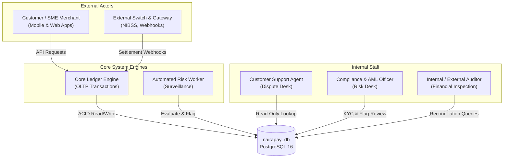
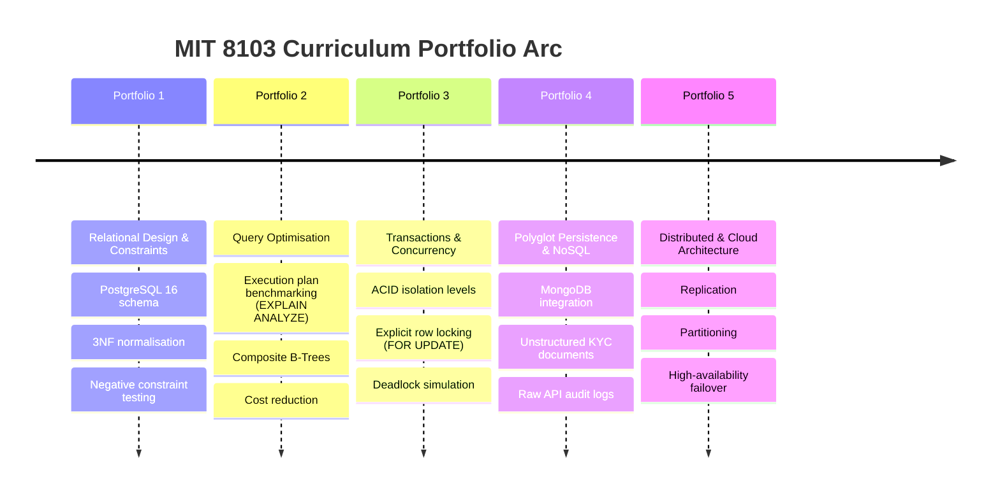

# Case Study: NairaPay (Simulated Fintech Platform)

**Course:** MIT 8103 – Advanced Database Systems  
**Module:** Portfolio 1 – Database Design and Modelling  
**Target System:** `nairapay_db` (PostgreSQL 16)  

---

## 1. Executive Summary & Industry Context

### 1.1 The Nigerian Fintech Landscape
Over the past decade, Nigeria has emerged as one of Africa's premier financial technology hubs. Driven by widespread smartphone adoption, a youthful demographic, and proactive regulatory frameworks from the Central Bank of Nigeria (CBN), digital payment platforms have largely bridged the gap left by traditional brick-and-mortar banking institutions. 

However, operating a financial technology platform in this environment introduces profound operational and technical hurdles:
- **Network Volatility & Interbank Drops:** Transactions routed through national settlement switches (e.g., NIBSS) and commercial banking APIs frequently suffer from network timeouts, delayed webhooks, and communication failures. Systems must withstand repeated user retries without issuing duplicate debits or credits.
- **Double-Spending & Concurrency Contention:** High-frequency peer-to-peer transfers and flash merchant transactions create severe concurrency challenges where two operations might attempt to spend the same wallet balance simultaneously.
- **Regulatory Scrutiny & Fraud:** Financial fraud, identity theft, and synthetic accounts demand strict Know-Your-Customer (KYC) onboarding tiers, Anti-Money Laundering (AML) monitoring, and compliance with the Nigeria Data Protection Act (NDPA).
- **Auditability and Non-Repudiation:** Financial records cannot simply be updated in place. Every movement of money must be permanently traceable, verifiable through mathematical reconciliation, and legally defensible.

### 1.2 Enterprise Profile: NairaPay Technologies Limited
**NairaPay Technologies Ltd.** is a simulated high-growth Nigerian payment service provider and mobile money operator. The platform provides digital wallet infrastructure, instant peer-to-peer (P2P) transfers, bill payments, and merchant collection tools to individual consumers, freelancers, and small-to-medium enterprises (SMEs) across Nigeria.

NairaPay operates on a digital-first model: customers interact with the platform through mobile applications and lightweight web interfaces, while the backend relies on an enterprise relational database management system (PostgreSQL 16) to guarantee absolute data consistency, zero financial drift, and ACID transaction isolation.

---

## 2. Regulatory, Compliance, and Security Framework

NairaPay operates in a heavily regulated domain. The database architecture is directly informed by statutory and international payment security mandates:

| Standard / Mandate | Regulatory Authority | Architecture & Schema Impact |
|---|---|---|
| **Tiered KYC Directive** | Central Bank of Nigeria (CBN) | Implements tiered onboarding verification. Tracks national identification numbers (`NIN`), Bank Verification Numbers (`BVN`), international passports, and driver's licences in `kyc_records` with distinct state transitions (`PENDING`, `VERIFIED`, `REJECTED`). |
| **NUBAN Standard** | CBN / Payments System Management | Enforces Nigeria Uniform Bank Account Number (NUBAN) conventions: all virtual and wallet account numbers are strictly 10-digit strings matching regex patterns (`^[0-9]{10}$`). |
| **PCI-DSS Compliance** | Payment Card Industry Security Standards Council | Mandates strict minimization of cardholder data. Full Primary Account Numbers (PAN), CVVs, and card PINs are **never** stored in the database. Only masked metadata (`last_four` digits, card type, expiry date) is preserved in `cards` for user identification. |
| **NDPA (2023)** | Nigeria Data Protection Commission (NDPC) | Protects personally identifiable information (PII). Restricts customer data cascading, enforces audit trails, and requires strict referential integrity. |
| **AML / CFT Acts** | NFIU & EFCC | Requires real-time surveillance of suspicious velocity and transaction amounts. Handled via the `fraud_flags` entity with risk scoring (0–100) and workflow statuses. |

---

## 3. Database Users and Actor Personas

The `nairapay_db` database is accessed by diverse actors with distinct operational profiles, concurrency patterns, and security privileges:



### 3.1 Detailed User Profiles

1. **Retail Customers & SME Merchants (OLTP End-Users):**
   - **Access Mode:** Low-latency mobile/web REST APIs mediated by application microservices.
   - **Key Operations:** Balance queries, wallet-to-wallet transfers, bank withdrawals, utility bill payments, beneficiary saving, card linking.
   - **Workload Profile:** High concurrency, latency-sensitive reads and atomic writes. Expects sub-second response times and immediate consistency.

2. **Customer Support & Dispute Agents:**
   - **Access Mode:** Internal customer relationship management (CRM) back-office portal.
   - **Key Operations:** Customer account lookup, beneficiary verification, transaction status tracking, locating root causes for failed/delayed transfers.
   - **Workload Profile:** Read-heavy queries with selective index lookups; strictly prohibited from directly altering transaction or ledger tables.

3. **Compliance, Fraud & AML Analysts:**
   - **Access Mode:** Risk surveillance dashboard.
   - **Key Operations:** Manual review of high-tier KYC submissions (validating identity documents against government records), triaging `fraud_flags`, freezing/unfreezing suspicious accounts, generating suspicious transaction reports (STRs).
   - **Workload Profile:** Complex filtered scans, range queries across timestamps and risk scores.

4. **Automated Core Banking & Ledger Engine:**
   - **Access Mode:** High-privilege backend daemon service connections using dedicated connection pools.
   - **Key Operations:** Executing multi-leg financial transfers, generating double-entry ledger postings, maintaining atomic cached balances, processing asynchronous bank webhook callbacks.
   - **Workload Profile:** Intensive transactional writes with strict ACID isolation requirements.

5. **Internal & External Financial Auditors:**
   - **Access Mode:** Read-only analytical queries and reconciliation batch scripts.
   - **Key Operations:** Verifying that $\sum \text{Debits} = \sum \text{Credits}$ across the platform; comparing current wallet balances in `accounts` with the cumulative sum of historical `ledger_entries`.
   - **Workload Profile:** Read-only historical scans and aggregations over large time periods.

---

## 4. System Scope and Major Data Domains

The NairaPay relational schema is structured into five core functional sub-domains, realized through 8 interconnected relational entities:

```
+---------------------------------------------------------------------------------+
|                                 NAIRAPAY DOMAINS                                |
+-----------------------+-----------------------+---------------------------------+
| 1. Customer & KYC     | 2. Wallets & Cards    | 3. Financial Transactions       |
|    - customers        |    - accounts         |    - transactions               |
|    - kyc_records      |    - cards            |    - ledger_entries             |
|                       |    - beneficiaries    |                                 |
+-----------------------+-----------------------+---------------------------------+
| 4. Risk & Compliance                          | 5. Reconciliation & Audit       |
|    - fraud_flags                              |    - double-entry verification  |
+-----------------------------------------------+---------------------------------+
```

### 4.1 Identity and Onboarding Domain (`customers`, `kyc_records`)
- **Customer Profiles:** Captures primary user identity (full legal name, unique email address, unique mobile phone number, customer type: `INDIVIDUAL` or `MERCHANT`, account status: `ACTIVE`, `SUSPENDED`, `CLOSED`).
- **Progressive KYC Verification:** Recognizes that identity verification is not a one-time static event. Users submit identification documents (`NIN`, `BVN`, `PASSPORT`, `DRIVERS_LICENCE`) that may be rejected or require re-submission. The database supports a 1-to-many relationship from `customers` to `kyc_records`, recording exact submission and verification timestamps with logical state guards.

### 4.2 Accounts and Payment Instruments (`accounts`, `cards`, `beneficiaries`)
- **NUBAN Digital Wallets:** Every customer can hold one or more accounts. Each account is assigned a unique 10-digit NUBAN account number, fixed currency (`NGN`), account status (`ACTIVE`, `FROZEN`, `CLOSED`), and a cached current balance.
- **Card Tokenization:** Allows customers to link virtual cards or physical debit cards to their wallets for card-based merchant checkouts. Implements PCI-DSS storage minimization: strictly 4 numeric digits (`last_four`), card type (`DEBIT`, `VIRTUAL`), expiration date, and lifecycle state (`ACTIVE`, `BLOCKED`, `EXPIRED`).
- **Beneficiary Directory:** Stores frequently used transfer recipients (bank name, 10-digit account number, beneficiary account name). Enforces composite uniqueness per customer to prevent cluttered, redundant payee lists.

### 4.3 Transaction Processing and Double-Entry Ledger (`transactions`, `ledger_entries`)
- **Business Event Tracking (`transactions`):** Represents high-level financial intentions (`DEPOSIT`, `WITHDRAWAL`, `TRANSFER`, `BILL_PAYMENT`, `REVERSAL`). Every transaction carries an external `idempotency_key` to guarantee safe retries under network failures.
- **Immutable Double-Entry Ledger (`ledger_entries`):** The operational core of NairaPay. Money is never created or destroyed; it is transferred between accounts. Every transaction generates at least two balanced ledger entries (one `DEBIT` and one `CREDIT`).
- **Running Balance Integrity:** Each ledger entry records the exact `balance_after` the operation, creating a tamper-evident financial audit trail that makes point-in-time balance reconstruction trivial.
- **Reversal Model:** Transactions are **never deleted or edited**. If an operation fails downstream or is disputed, a dedicated compensating `REVERSAL` transaction is created, referencing the original via `reversal_of`.

### 4.4 Risk Surveillance and Fraud Prevention (`fraud_flags`)
- **Automated Anomaly Detection:** Suspicious activities (e.g., sudden velocity spikes, rapid off-hours withdrawals, geographic anomalies) trigger automated fraud flags tied to specific transactions.
- **Risk Quantification:** Each flag assigns a calibrated `risk_score` (between 0 and 100), a categorical reason, and tracks investigation lifecycle statuses (`OPEN`, `UNDER_REVIEW`, `CLEARED`, `CONFIRMED`).

---

## 5. Key Business Workflows and Operational Lifecycles

### 5.1 Peer-to-Peer (P2P) Wallet Transfer
When Customer A transfers funds to Customer B, the database coordinates an atomic, multi-table sequence:

```
[Customer A Initiates N5,000 Transfer]
                  │
                  ▼
   1. Check Idempotency Key ──────> Exists? ──> Return Prior Result (No Duplicate)
                  │
                  ▼ (New Request)
   2. Lock Sender Account (SELECT ... FOR UPDATE)
   3. Check Balance >= N5,000 AND Status = 'ACTIVE'
                  │
                  ▼
   4. INSERT INTO transactions (idempotency_key, txn_type='TRANSFER', amount=5000.00, status='COMPLETED')
                  │
                  ▼
   5. INSERT INTO ledger_entries:
      ├── Line 1: account_id = Sender,   direction = 'DEBIT',  amount = 5000.00, balance_after = Old - 5000
      └── Line 2: account_id = Receiver, direction = 'CREDIT', amount = 5000.00, balance_after = Old + 5000
                  │
                  ▼
   6. UPDATE accounts (balance = balance - 5000 WHERE account_id = Sender)
   7. UPDATE accounts (balance = balance + 5000 WHERE account_id = Receiver)
                  │
                  ▼
             [COMMIT ACID]
```

### 5.2 Transaction Reversal Workflow
If an outbound bank transfer fails at the interbank settlement switch after the customer's wallet has already been debited:
1. The original transaction status is updated to `REVERSED`.
2. A new transaction is inserted with `txn_type = 'REVERSAL'`, referencing the parent transaction ID in `reversal_of`.
3. Symmetrical compensating ledger entries are posted (crediting the customer's wallet and debiting the clearing/suspense account).
4. The database enforces via CHECK constraints that any transaction typed `REVERSAL` **must** have a non-null `reversal_of` foreign key, and conversely, non-reversal transactions **must not** populate this column.

---

## 6. Architectural Invariants and Database Constraints

To protect financial integrity without relying solely on application-layer validation, `nairapay_db` implements defensive database-level constraints:

| Invariant / Rule | SQL Mechanism | Rationale / Failure Prevented |
|---|---|---|
| **No Floating-Point Money** | `NUMERIC(19,4)` | Prohibits IEEE 754 floating-point rounding errors (e.g., `0.1 + 0.2 != 0.3`). Guarantees sub-kobo precision. |
| **Non-Negative Balances** | `CHECK (balance >= 0)` | Prevents wallets from dropping below zero due to race conditions or application bugs. |
| **Double-Entry Balance** | Debit/Credit balance parity | Ensures every transfer debits one account and credits another by the identical monetary amount. |
| **Strict Idempotency** | `UNIQUE (idempotency_key)` | Completely neutralizes duplicate charge risks when mobile clients retry dropped connections. |
| **Reversal Symmetry** | `CHECK ((txn_type = 'REVERSAL') = (reversal_of IS NOT NULL))` | Enforces complete bidirectional integrity: no orphan reversals, and no standard transactions disguised as reversals. |
| **Strict NUBAN Format** | `CHECK (account_number ~ '^[0-9]{10}$')` | Prevents malformed, truncated, or non-numeric account numbers from entering the database. |
| **Card Data Masking** | `CHECK (last_four ~ '^[0-9]{4}$')` | Guarantees compliance with PCI-DSS storage restrictions at the schema level. |
| **Financial Immutability** | `ON DELETE RESTRICT` | Prevents cascading deletions from wiping out customer audit trails, accounts, transactions, or ledger entries. |
| **Beneficiary Disposability** | `ON DELETE CASCADE` | Allows non-financial convenience records (saved beneficiaries) to cleanly cascade if a customer profile is removed. |
| **KYC Audit Consistency** | `CHECK (verified_at IS NULL OR verification_status <> 'PENDING')` | Guarantees that pending KYC submissions cannot have a verification timestamp before a review outcome is reached. |

---

## 7. Mapping to Portfolio Arc & Academic Roadmap

This case study establishes the transactional baseline for the five portfolios comprising the **MIT 8103 Advanced Database Systems** curriculum:



- **Portfolio 1 (Current):** Conceptual, logical, and physical relational modeling, 3NF normalisation, declarative constraint enforcement, and negative testing.
- **Portfolio 2:** Index design and query optimization. Performance indexes on high-traffic columns (`ledger_entries.account_id`, `transactions.initiated_at`) are intentionally omitted in Portfolio 1 to facilitate baseline comparison in Portfolio 2.
- **Portfolio 3:** Concurrency control and ACID isolation levels. Evaluates transactional locks, race conditions during high-volume wallet transfers, and deadlock prevention mechanisms.
- **Portfolio 4:** Polyglot persistence. Offloads high-volume semi-structured payloads (raw payment webhook payloads, binary KYC document scans, unstructured audit events) to MongoDB.
- **Portfolio 5:** Scalability and distributed systems. Evaluates table partitioning for historical ledger entries, read-replica scaling, and high-availability deployment patterns.