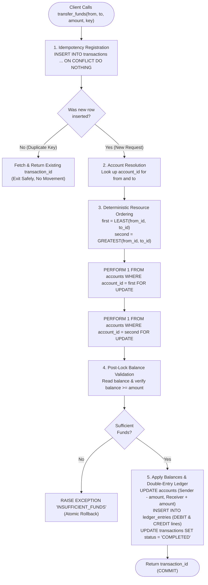

# Portfolio 3: Transactions and Concurrency Control

**Case study:** NairaPay, a simulated Nigerian fintech wallet and transfer platform  
**Course:** MIT 8103 – Advanced Database Systems  
**DBMS:** PostgreSQL 16.14 (Homebrew / aarch64-apple-darwin), managed with psql and pgAdmin 4  
**Database:** `nairapay_db`  
**Detailed Technical Analysis:** [analysis.md](analysis.md)  
**Interactive Runbook:** [04_concurrency_runbook.md](04_concurrency_runbook.md)  

---

## 1. Project Overview

In **Portfolio 1**, the foundational schema for `nairapay_db` was engineered with strict referential integrity, check constraints, and double-entry ledger structures. In **Portfolio 2**, performance indexes were deployed and tuned, optimizing execution plans and buffer consumption across critical OLTP access paths.

**Portfolio 3** investigates the core transactional backbone of the NairaPay platform: **ACID guarantees**, **multi-session concurrency control**, **row-level locking mechanisms**, **isolation level trade-offs**, and **deadlock prevention under high contention**.

In digital payment platforms, high-volume peer-to-peer (P2P) transfers and merchant settlements frequently touch the same wallet rows concurrently. Without robust database-level concurrency control, systems succumb to catastrophic anomalies:
1. **Lost Updates & Double Spending:** Simultaneous debit operations reading outdated cached balances and overwriting each other without throwing errors.
2. **Non-Repeatable Reads & Phantom Records:** Reporting and audit transactions observing inconsistent intermediate states during concurrent modifications.
3. **Deadlock Cycles:** Bidirectional fund movements waiting mutually on row-level locks, causing transaction aborts, multi-second latency spikes, and severe throughput degradation.
4. **Ledger Discrepancies:** Partial transaction execution corrupting double-entry accounting invariants.

This portfolio demonstrates how to architect a bulletproof, production-grade fund transfer stored procedure (`transfer_funds()`) in PL/pgSQL that achieves sub-millisecond execution, guarantees strict idempotency, eliminates deadlocks through deterministic resource ordering, and maintains absolute mathematical conservation of money under high-concurrency stress.

---

## 2. Repository Structure

```
portfolio-3-transactions-concurrency/
├── README.md                          # Project summary, reproduction guide, and empirical results (this file)
├── analysis.md                        # Comprehensive theoretical, architectural, and benchmark report
├── 01_transfer_function.sql           # Production stored procedure transfer_funds() & flawed demo function
├── 02_demo_setup.sql                  # Resets Demo Alice and Bob wallets for interactive isolation experiments
├── 03_commit_rollback_demo.sql        # Batch demonstration of COMMIT, ROLLBACK, abort, idempotency, and SAVEPOINT
├── 04_concurrency_runbook.md          # Step-by-step interactive multi-terminal runbook (Experiments 1–5)
├── 05_stress_ordered.pgbench          # High-contention pgbench script using ordered locking (deadlock-free)
├── 06_stress_unordered.pgbench        # High-contention pgbench script using unordered locking (deadlock-prone)
├── 07_integrity_check.sql             # Financial invariant verification queries (pre- and post-stress audits)
├── output/                            # Verifiable terminal outputs and raw benchmark logs
│   ├── 03_commit_rollback_output.txt  # Execution log of transaction primitives demo
│   ├── integrity_before.txt           # Financial invariants before stress testing
│   ├── stress_ordered.txt             # Benchmark log: 10 clients, 2,000 txns, 7,822 TPS, 0 failures
│   ├── integrity_after_ordered.txt    # Invariant verification after ordered stress run (2,000 txns)
│   ├── stress_unordered.txt           # Benchmark log: 10 clients, 2,000 txns, 47.6 TPS, 56 deadlock failures
│   └── integrity_after_unordered.txt  # Invariant verification after unordered stress run (3,944 total txns)
└── screenshots/                       # High-resolution terminal evidence of multi-session experiments
    ├── 01_function_test.png           # Stored procedure deployment and baseline execution test
    ├── 02_commit_rollback_output.png  # Execution of commit/rollback/idempotency/savepoint script
    ├── 03_exp1_lost_update.png        # Experiment 1: Side-by-side terminal capture of the Lost Update anomaly
    ├── 04_exp2_lock_released.png      # Experiment 2: Lock released on COMMIT, unblocking session B
    ├── 05_exp2_lock_waiting.png       # Experiment 2: Session B waiting on tuple lock in pg_stat_activity
    ├── 06_exp3a_read_committed.png    # Experiment 3a: Non-repeatable read under READ COMMITTED
    ├── 07_exp3b_repeatable_read.png   # Experiment 3b: Snapshot isolation & serialization failure under REPEATABLE READ
    ├── 08_exp4_deadlock.png           # Experiment 4: Circular wait deadlock detection and engine abort
    ├── 09_stress_results.png          # Experiment 5: pgbench stress comparison (Ordered vs Unordered)
    ├── 10_integrity.png               # Experiment 5: Invariant verification audit (0 drift across 1 Trillion NGN)
    └── accounts with a positive balance.png # Wallet verification query output
```

---

## 3. Core Architecture: `transfer_funds()`

The production transfer procedure in `01_transfer_function.sql` enforces five non-negotiable architectural layers:



### Architectural Safeguards:
1. **Idempotency-First Registration:** The incoming UUID request key (`p_key`) is registered immediately into `transactions`. If an identical network retry arrives, `ON CONFLICT (idempotency_key) DO NOTHING` prevents double processing and returns the original `transaction_id`.
2. **Deterministic Ordered Locking:** Instead of locking the sender first and receiver second (which causes deadlocks when bidirectional transfers collide), the procedure evaluates:
   $$\text{first\_id} = \min(\text{from\_id}, \text{to\_id}), \quad \text{second\_id} = \max(\text{from\_id}, \text{to\_id})$$
   Because all concurrent sessions acquire row locks in the exact same numerical sequence, a circular wait cycle is mathematically impossible (eliminating Coffman's fourth deadlock condition).
3. **Post-Lock Balance Verification:** Balances are evaluated *only after* exclusive row locks (`FOR UPDATE`) are granted. This completely prevents race conditions and overdrafts.
4. **Double-Entry Journaling:** Every transfer writes exactly one `DEBIT` and one `CREDIT` line into `ledger_entries`, recording the resulting `balance_after`.
5. **Monotonic Real-Time Timestamps:** Uses `clock_timestamp()` rather than `now()`. Under transaction pooling and concurrency, `now()` returns the transaction start time, which could cause a later-executed statement to receive an earlier timestamp than an already-committed transaction.

---

## 4. Empirical Benchmark Summary

Stress testing was executed using `pgbench` running **10 concurrent clients** across **4 OS worker threads** targeting a hot set of **20 active wallets** (`2200001001` through `2200001020`), generating extreme lock contention.

### 4.1 Benchmark Comparison Table

| Metric | Ordered Locking (`transfer_funds`) | Unordered Locking (`transfer_funds_unordered`) | Variance / Impact |
|---|---|---|---|
| **Concurrency Parameters** | 10 clients, 4 threads, 200 txns/client | 10 clients, 4 threads, 200 txns/client | Identical workload & scale |
| **Total Transactions Attempted** | 2,000 | 2,000 | Baseline equivalent |
| **Transactions Successfully Processed** | **2,000 / 2,000** | 1,944 / 2,000 | 56 failed transactions |
| **Failed Transactions (Deadlocks)** | **0 (0.000%)** | **56 (2.800%)** | **100% elimination of deadlocks** |
| **Average Transaction Latency** | **1.278 ms** | **204.135 ms** | **159.7× latency reduction** |
| **Throughput (Transactions Per Second)** | **7,822.49 TPS** | **47.62 TPS** | **164.3× higher throughput** |
| **Initial Connection Overhead** | 35.351 ms | 33.763 ms | Parity (~34 ms) |
| **Post-Test Invariant Violations** | **0** | **0** | Perfect ACID atomicity on abort |

### 4.2 Financial Invariant Audit Verification

The financial integrity suite (`07_integrity_check.sql`) was executed before the tests, after the ordered stress test, and after the unordered stress test:

```
========================================================================================
AUDIT STAGE         TOTAL MONEY IN SYSTEM     TRANSFERS    UNBALANCED    MISMATCHED    PENDING
----------------------------------------------------------------------------------------
1. Baseline Pre-Test  1,000,000,000,000.0000 NGN        0            0             0          0
2. Post-Ordered       1,000,000,000,000.0000 NGN    2,000            0             0          0
3. Post-Unordered     1,000,000,000,000.0000 NGN    3,944            0             0          0
========================================================================================
```
*Note: `total_money_in_system` remained exactly invariant at `1,000,000,000,000.0000` NGN (One Trillion Naira). Zero unbalanced journals, zero account discrepancies, and zero stuck transactions occurred, proving that even when 56 transactions aborted due to deadlocks, PostgreSQL's WAL and atomic rollback engine prevented any ledger corruption.*

---

## 5. Step-by-Step Reproduction Guide

All demonstrations can be reproduced on macOS/Linux using standard PostgreSQL client utilities (`psql` and `pgbench`).

### Step 1: Deploy Transfer Function and Reset Wallets
Connect to `nairapay_db` and deploy the stored procedure:
```bash
psql -d nairapay_db -f 01_transfer_function.sql
psql -d nairapay_db -f 02_demo_setup.sql
```

### Step 2: Run Transaction Primitives Demonstration
Execute the automated batch demonstration of `COMMIT`, `ROLLBACK`, system failure handling, idempotency retries, and `SAVEPOINT`:
```bash
psql -d nairapay_db -a -f 03_commit_rollback_demo.sql -o output/03_commit_rollback_output.txt
```

### Step 3: Run Interactive Multi-Session Concurrency Experiments
Open three side-by-side terminal tabs (`psql -d nairapay_db`) and follow [04_concurrency_runbook.md](04_concurrency_runbook.md):
- **Experiment 1 (Lost Update):** Two sessions read balance 500.00 simultaneously, subtract 400.00 locally, and write back 100.00. Balance ends at 100.00 instead of -300.00 or rejecting. Proves why application-level calculation without locking loses money silently.
- **Experiment 2 (`FOR UPDATE` Locking):** Session A acquires exclusive lock; Session B blocks with `wait_event_type = 'Lock'`. When Session A commits, Session B unblocks, reads the updated balance (100.00), and rejects the withdrawal.
- **Experiment 3a (Read Committed):** Demonstrates non-repeatable reads where repeated SELECTs inside the same transaction observe concurrent external commits.
- **Experiment 3b (Repeatable Read):** Demonstrates snapshot isolation. Concurrent write causes `ERROR: could not serialize access due to concurrent update`, requiring an application retry loop.
- **Experiment 4 (Deadlock Cycle):** Unordered bidirectional transfers produce circular wait dependencies, resolved when PostgreSQL's deadlock detector kills one transaction with `ERROR: deadlock detected`.

### Step 4: Run High-Contention Stress Benchmarks
Execute the automated benchmarking suite:
```bash
# Capture pre-test baseline
psql -d nairapay_db -f 07_integrity_check.sql -o output/integrity_before.txt

# Benchmark 1: Ordered Locking (Deadlock-Free)
pgbench -n -c 10 -j 4 -t 200 -f 05_stress_ordered.pgbench nairapay_db | tee output/stress_ordered.txt
psql -d nairapay_db -f 07_integrity_check.sql -o output/integrity_after_ordered.txt

# Benchmark 2: Unordered Locking (Deadlock-Prone)
pgbench -n -c 10 -j 4 -t 200 -f 06_stress_unordered.pgbench nairapay_db | tee output/stress_unordered.txt
psql -d nairapay_db -f 07_integrity_check.sql -o output/integrity_after_unordered.txt
```

---

## 6. Photographic Evidence Inventory

High-resolution visual evidence of all experiments is catalogued in `screenshots/`:

| Screenshot File | Description & Visual Evidence |
|---|---|
| `screenshots/01_function_test.png` | Deployment of `transfer_funds()` and initial functional verification. |
| `screenshots/02_commit_rollback_output.png` | Terminal execution of `03_commit_rollback_demo.sql` demonstrating atomic commit, rollback, and idempotency key conflict handling. |
| `screenshots/03_exp1_lost_update.png` | Side-by-side terminal capture of Experiment 1: Two sessions overwriting balance without row locking, demonstrating the silent Lost Update anomaly. |
| `screenshots/04_exp2_lock_released.png` | Experiment 2: Terminal B unblocks and reads the updated balance immediately upon Terminal A's `COMMIT`. |
| `screenshots/05_exp2_lock_waiting.png` | Experiment 2: Terminal C query on `pg_stat_activity` showing Terminal B in `wait_event_type = 'Lock'` on tuple lock. |
| `screenshots/06_exp3a_read_committed.png` | Experiment 3a: Non-repeatable read under default READ COMMITTED isolation. |
| `screenshots/07_exp3b_repeatable_read.png` | Experiment 3b: Snapshot isolation stability followed by `ERROR: 40001 could not serialize access` on concurrent update. |
| `screenshots/08_exp4_deadlock.png` | Experiment 4: Multi-session deadlock demonstration showing PostgreSQL engine cycle abort (`ERROR: deadlock detected`). |
| `screenshots/09_stress_results.png` | Experiment 5: Side-by-side comparison of `pgbench` stress tests showing 7,822 TPS (ordered) vs 47.6 TPS with 56 deadlocks (unordered). |
| `screenshots/10_integrity.png` | Experiment 5: Execution of `07_integrity_check.sql` verifying 1 Trillion NGN exact balance and zero financial discrepancies. |
| `screenshots/accounts with a positive balance.png` | Wallet distribution query verifying positive ledger-backed balances across accounts. |

---

## 7. Key Engineering Takeaways

1. **Lock Before Reading, Not After:** Checking a balance via standard `SELECT` and computing the difference in application code creates a catastrophic race condition. In financial systems, rows must be locked exclusively (`FOR UPDATE`) *before* balances are examined.
2. **Deterministic Resource Ordering Eliminates Deadlocks:** Sorting locks by primary key (`LEAST` and `GREATEST`) breaks Coffman's circular wait condition mathematically, yielding a **164× throughput improvement** under high contention.
3. **Idempotency Must Be First-Class:** Registering the idempotency key atomically before taking locks prevents duplicate debits during network timeouts or aggressive client retries.
4. **Deadlock Rollbacks Preserve Atomicity but Destroy Throughput:** PostgreSQL's deadlock detector correctly aborts circular waits, protecting database invariants. However, the 1-second detection pause degrades throughput from 7,822 TPS to 47.6 TPS. Deadlocks must be prevented architecturally rather than handled reactively.
5. **Double-Entry Ledger Invariance:** Auditing total system currency ($10^{12}$ NGN) before and after thousands of concurrent operations proves that relational ACID engines provide mathematically defensible financial guarantees.

---

## 8. Author & Academic Context

- **Course:** MIT 8103 – Advanced Database Systems
- **Institution:** MIVA Open University
- **Deliverable:** Portfolio 3 – Transactions and Concurrency Control
- **Database Engine:** PostgreSQL 16.14 (Homebrew / aarch64-apple-darwin)

