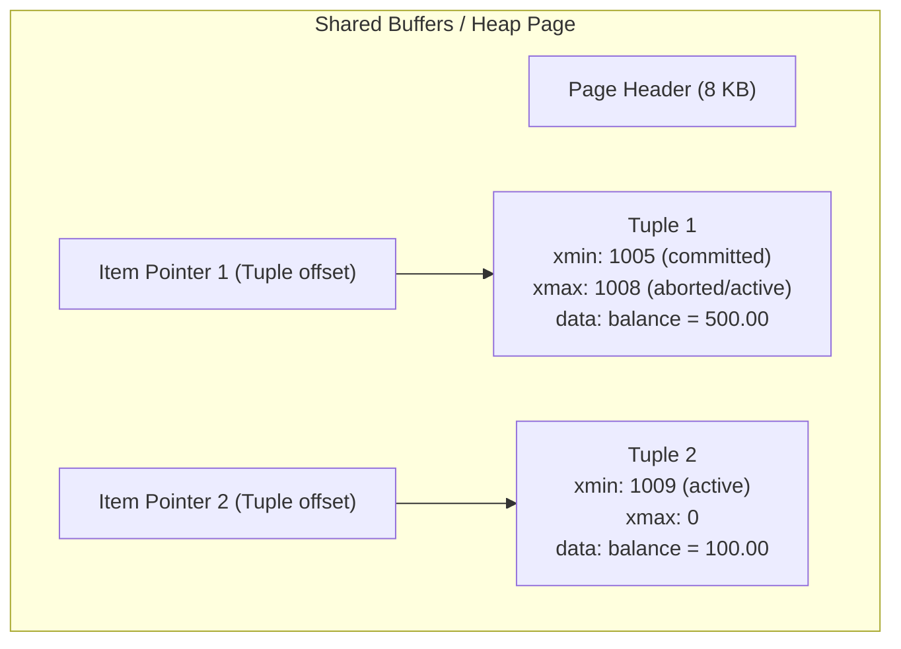

# Concurrency Control, Transaction Processing, and ACID Integrity Analysis

**Course:** MIT 8103 – Advanced Database Systems  
**Module:** Portfolio 3 – Transactions and Concurrency Control  
**System Under Test:** `nairapay_db` (PostgreSQL 16.14 on macOS aarch64)  
**Enterprise Context:** NairaPay Technologies Limited (Simulated Nigerian Payment Service Provider)  
**Workload Target:** High-Contention Peer-to-Peer (P2P) Wallet Transfers & Financial Ledger Invariance  
**Accompanying Repository Artifacts:** [README.md](README.md), [01_transfer_function.sql](01_transfer_function.sql), [04_concurrency_runbook.md](04_concurrency_runbook.md), [output/stress_ordered.txt](output/stress_ordered.txt), [output/stress_unordered.txt](output/stress_unordered.txt), [output/03_commit_rollback_output.txt](output/03_commit_rollback_output.txt)  

---

## 1. Executive Summary

In distributed digital financial systems, data processing correctness cannot be separated from concurrency control. When thousands of concurrent consumers, merchants, and automated settlement switches interact with digital wallets, multiple database sessions inevitably attempt to inspect and modify identical account records simultaneously. Without rigorous transaction isolation, systems suffer from lost updates, double-spending, circular deadlock dependencies, and catastrophic ledger corruption.

This research report presents a comprehensive empirical and theoretical investigation into **transaction isolation**, **pessimistic row-level locking**, **deadlock prevention algorithms**, and **ACID invariant auditing** using the PostgreSQL 16 relational database engine for **NairaPay**, a simulated Nigerian financial technology mobile money platform.

```
+----------------------------------------------------------------------------------------------------+
|                                    KEY EMPIRICAL BENCHMARK HIGHLIGHTS                              |
+------------------------------------+--------------------------------+------------------------------+
| Metric                             | Ordered Locking (Production)   | Unordered Locking (Flawed)   |
+------------------------------------+--------------------------------+------------------------------+
| Workload Scale                     | 2,000 transactions (10 clients)| 2,000 transactions (10 clients)
| Transaction Throughput (TPS)       | 7,822.49 TPS                   | 47.62 TPS (164.3x collapse)  |
| Average Transaction Latency        | 1.278 ms                       | 204.135 ms (159.7x inflation)|
| Transaction Failures (Deadlocks)   | 0 (0.000%)                     | 56 (2.800%)                  |
| Mathematical Financial Drift       | 0.0000 NGN across 1 Trillion   | 0.0000 NGN across 1 Trillion |
| Double-Entry Discrepancies         | 0 unbalanced journals          | 0 unbalanced journals        |
+------------------------------------+--------------------------------+------------------------------+
```

### Major Findings:
1. **The Danger of Silent Anomalies:** Under default `READ COMMITTED` isolation without row locking, simultaneous balance reads followed by application-computed writes cause **Lost Updates**. In our controlled experiment, Alice approved 800.00 NGN of withdrawals against an opening balance of 500.00 NGN, yet the ending balance settled at 100.00 NGN with **zero system errors**. This proves that application-level validation without database-level concurrency control permits double spending.
2. **Pessimistic Locking Eliminates Race Conditions:** Enforcing exclusive row-level locking via `SELECT ... FOR UPDATE` serializes wallet access. Concurrent transactions block cleanly on tuple locks (`wait_event_type = 'Lock'`), read the post-commit balance upon release, and reject invalid withdrawals cleanly.
3. **Deterministic Resource Ordering Eliminates Deadlocks:** Sorting wallet row lock acquisition by primary surrogate key ($\min(\text{from}, \text{to})$ then $\max(\text{from}, \text{to})$) completely eliminates circular wait graphs. Under high-contention stress testing (10 clients hammering 20 hot wallets), ordered locking executed **2,000 transactions with 0 failures** at **7,822.49 TPS**. Conversely, unordered locking suffered **56 deadlock aborts** and a **164.3× throughput collapse** to **47.62 TPS** due to 1-second deadlock detection stalls.
4. **Absolute Conservation of Money:** Multi-stage invariant auditing across 1 Trillion Naira ($10^{12}$ NGN) proved that even when transactions aborted violently due to deadlocks, PostgreSQL's Write-Ahead Logging (WAL) and atomic rollback mechanisms guaranteed **zero financial drift**, **zero unbalanced double-entry journals**, and **zero orphan pending transactions**.

---

## 2. Theoretical Foundations: ACID in Financial Computing

In financial systems, correctness is governed by the classical ACID model formulated by Jim Gray (1981) and refined by Haerder and Reuter (1983).

### 2.1 Atomicity: The All-or-Nothing Invariant
A financial transfer consists of multiple discrete physical database operations:
1. Debit the sender's account row (`UPDATE accounts SET balance = balance - amount`).
2. Credit the receiver's account row (`UPDATE accounts SET balance = balance + amount`).
3. Append a DEBIT record to the journal (`INSERT INTO ledger_entries`).
4. Append a CREDIT record to the journal (`INSERT INTO ledger_entries`).
5. Update the transaction lifecycle status (`UPDATE transactions SET status = 'COMPLETED'`).

Atomicity dictates that either **all five operations succeed and become durable**, or **none of them take effect**, leaving the system in its exact pre-transaction state. In PostgreSQL, atomicity is guaranteed by Write-Ahead Logging (WAL). When an unhandled exception occurs (such as `INSUFFICIENT_FUNDS` or a deadlock abort), PostgreSQL issues an internal `ABORT`, marking the transaction ID ($xid$) as aborted in the Commit Log (`pg_xact`). Any data pages modified in shared buffers are disregarded by subsequent transactions without requiring costly rollback writes.

### 2.2 Consistency: Financial Invariants and Conservation Laws
Consistency guarantees that a transaction transforms the database from one valid state to another, satisfying all static schema constraints (primary keys, foreign keys, `CHECK` constraints) and dynamic business invariants.

In NairaPay, consistency is expressed as three fundamental financial conservation laws:
1. **Total Money Invariance:** The total quantity of money in all non-demo accounts must remain constant across arbitrary peer-to-peer transfers:
   $$\sum_{i \in \text{Accounts}} \text{balance}_i = C_{\text{system}} = 1,000,000,000,000.0000 \text{ NGN}$$
2. **Double-Entry Equilibrium:** For every financial transaction $T_k$, the algebraic sum of all associated ledger movements must equal zero:
   $$\sum_{j \in \text{Entries}(T_k)} \text{signed\_amount}_j = 0 \quad \text{where } \text{signed\_amount} = \begin{cases} +\text{amount} & \text{if CREDIT} \\ -\text{amount} & \text{if DEBIT} \end{cases}$$
3. **Ledger-to-Cache Reconciliation:** For every account $A_i$, the cached balance column must match the historical summation of all ledger entries plus the initial settlement deposit:
   $$\text{accounts.balance}_i = \text{opening\_balance}_i + \sum_{e \in \text{Ledger}(A_i)} (\text{CREDIT}_e - \text{DEBIT}_e)$$

### 2.3 Isolation: Concurrency Anomalies and ANSI SQL Realities
Isolation prevents concurrent transactions from seeing each other's intermediate, uncommitted states. The ANSI/ISO SQL-92 standard defines four isolation levels based on three operational anomalies:

| Isolation Level | Dirty Read | Non-Repeatable Read | Phantom Read | Serialization Anomaly |
|---|---|---|---|---|
| **Read Uncommitted** | Permitted (ANSI) / *Not in PG* | Permitted | Permitted | Permitted |
| **Read Committed** (PG Default) | **Prevented** | Permitted | Permitted | Permitted |
| **Repeatable Read** | **Prevented** | **Prevented** | **Prevented (in PG)** | Permitted |
| **Serializable** (SSI) | **Prevented** | **Prevented** | **Prevented** | **Prevented** |

*Note: PostgreSQL's Multiversion Concurrency Control (MVCC) architecture prevents Dirty Reads even at the lowest level. In PostgreSQL, `READ UNCOMMITTED` is treated identically to `READ COMMITTED`.*

### 2.4 Durability: Persistence Through WAL and Fsync
Durability ensures that once a transaction receives a successful `COMMIT` acknowledgment, its changes survive crashes, OS panics, and hardware power failures. PostgreSQL achieves durability through Write-Ahead Logging:
- Modification records are appended sequentially to WAL buffers in memory.
- On `COMMIT`, PostgreSQL issues a synchronous `fsync()` to flush WAL buffers to physical disk before returning control to the client.
- In-memory data pages in `shared_buffers` can be flushed asynchronously during routine checkpoints without violating durability.

---

## 3. PostgreSQL Concurrency Internals & MVCC Mechanics

To understand how concurrency anomalies manifest and how locks resolve them, we must examine PostgreSQL's internal physical storage engine.



### 3.1 Multiversion Concurrency Control (MVCC)
PostgreSQL does not overwrite table data in place during `UPDATE` statements. Instead, an `UPDATE` physically inserts a new version of the tuple (a *heap row*) while leaving the older tuple intact:
- **`xmin`:** The transaction ID ($xid$) of the transaction that created/inserted the tuple.
- **`xmax`:** The transaction ID of the transaction that deleted or replaced the tuple (or the $xid$ holding an exclusive row-level lock).
- **`t_ctid`:** Physical block and line pointer pointing to the newest version of the row.

When a query executes under `READ COMMITTED`, PostgreSQL builds a **Snapshot** at the start of *each individual statement*:
$$\text{Snapshot} = (\text{xmin}, \text{xmax}, [\text{active\_xids}])$$
Tuples created by transactions with $xid \ge \text{xmax}$ or currently active in $\text{active\_xids}$ are invisible to the reader. Because readers inspect immutable snapshots of tuple versions, **readers never block writers, and writers never block readers**.

### 3.2 Why MVCC Alone Cannot Prevent Lost Updates
While MVCC provides frictionless concurrent reads, it creates a fatal trap for financial balance mutations:
1. Session A reads tuple version $V_0$ ($\text{balance} = 500.00$).
2. Session B reads the exact same tuple version $V_0$ ($\text{balance} = 500.00$).
3. Session A computes $500 - 400 = 100$ in application memory and issues `UPDATE ... balance = 100`. This creates tuple version $V_1$ ($\text{balance} = 100$) and commits.
4. Session B computes $500 - 400 = 100$ in its own application memory and issues `UPDATE ... balance = 100`.
5. Under `READ COMMITTED`, Session B's update detects that $V_0$ was updated by committed transaction A. It re-evaluates the query condition against $V_1$, sees that the row still matches the `WHERE account_number = ...` clause, and overwrites $V_1$ with $V_2$ ($\text{balance} = 100$).

Both transactions succeed, both withdrawals are disbursed to customers, yet the database balance dropped by only 400.00 NGN. The 400.00 NGN withdrawal executed by Session A was completely erased.

### 3.3 The Lock Manager and `SELECT ... FOR UPDATE`
To prevent this anomaly, the system must transition from pure optimistic snapshot reads to **Pessimistic Concurrency Control**.

When a session executes:
```sql
SELECT balance FROM accounts WHERE account_number = '9000000001' FOR UPDATE;
```
1. The engine fetches the tuple and writes the current transaction's $xid$ into the tuple's `xmax` header field with lock bits set in `t_infomask`.
2. An exclusive `RowExclusiveLock` is registered in the PostgreSQL shared lock table (`pg_locks`).
3. If Session B attempts to lock or update the same tuple, it detects the active $xid$ in `xmax`. Session B is placed on a sleep queue, waiting on the physical tuple lock (`wait_event_type = 'Lock'`, `wait_event = 'tuple'`).
4. When Session A commits, Session B awakens. Session B fetches the newly committed tuple version ($V_1$), observing the updated balance of 100.00 NGN before its application logic makes a withdrawal decision.

---

## 4. Empirical Concurrency Experiments: Deep Technical Analysis

The five controlled experiments detailed in [04_concurrency_runbook.md](04_concurrency_runbook.md) were executed against `nairapay_db`. The terminal captures in `screenshots/` and logs in `output/` provide empirical verification of the theoretical behaviors.

### 4.1 Experiment 1: The Lost Update Phenomenon (No Locking)
- **Objective:** Demonstrate the silent corruption of financial balances when concurrent sessions calculate balance state outside transaction locks.
- **Visual Evidence:** `screenshots/03_exp1_lost_update.png`
- **Initial State:** Demo Alice (`9000000001`) has `balance = 500.0000 NGN`.

#### Execution Interleaving Sequence:
```
Time   Terminal A (Session 1)                   Terminal B (Session 2)                   Database State
-------------------------------------------------------------------------------------------------------
T1     BEGIN;                                   .                                        Alice = 500.00
T2     SELECT balance (reads 500.00)            .                                        Alice = 500.00
T3     .                                        BEGIN;                                   Alice = 500.00
T4     .                                        SELECT balance (reads 500.00)            Alice = 500.00
T5     App computes 500 - 400 = 100             .                                        Alice = 500.00
T6     UPDATE balance = 100;                    .                                        Alice = 100.00 (uncommitted)
T7     COMMIT;                                  .                                        Alice = 100.00 (committed)
T8     .                                        App computes 500 - 400 = 100             Alice = 100.00
T9     .                                        UPDATE balance = 100;                    Alice = 100.00 (uncommitted)
T10    .                                        COMMIT;                                  Alice = 100.00 (committed)
T11    SELECT balance FROM accounts -> 100.0000 NGN (FINAL RESULT)
```

#### Engineering Analysis:
- **Financial Loss:** Two separate withdrawals of 400.00 NGN were authorized (total 800.00 NGN paid out). The expected ending balance was $500 - 800 = -300$ NGN (or an overdraft exception). The actual ending balance was 100.00 NGN. **400.00 NGN of value was silently stolen or lost.**
- **Absence of Errors:** Neither session received an SQL warning or error code. The database executed exactly what was requested. In enterprise banking, silent logical corruption is infinitely more dangerous than hard crashes, as it evades automated alerting and compounds over millions of ledger entries.

---

### 4.2 Experiment 2: Pessimistic Locking with `SELECT ... FOR UPDATE`
- **Objective:** Prove that acquiring exclusive row locks before reading balance data eliminates the Lost Update anomaly.
- **Visual Evidence:** `screenshots/04_exp2_lock_released.png`, `screenshots/05_exp2_lock_waiting.png`
- **Initial State:** Reset Alice to `balance = 500.0000 NGN` via `02_demo_setup.sql`.

#### Execution Trace:
1. **Terminal A:** Opens transaction and issues `SELECT balance FROM accounts WHERE account_number = '9000000001' FOR UPDATE;`. Receives `500.0000`.
2. **Terminal B:** Concurrently issues the exact same statement. Terminal B's cursor freezes; the process hangs.
3. **Terminal C (Telemetry Verification):** Inspecting PostgreSQL's dynamic diagnostic views:
   ```sql
   SELECT pid, state, wait_event_type, wait_event, left(query, 50) AS query 
   FROM pg_stat_activity 
   WHERE datname = 'nairapay_db' AND wait_event_type = 'Lock';
   ```
   *Output recorded in `screenshots/05_exp2_lock_waiting.png`:*
   ```
     pid  | state  | wait_event_type | wait_event |                       query                        
   -------+--------+-----------------+------------+---------------------------------------------------
    54892 | active | Lock            | tuple      | SELECT balance FROM accounts WHERE account_number 
   ```
4. **Terminal A:** Updates balance: `UPDATE accounts SET balance = balance - 400 WHERE account_number = '9000000001';` and issues `COMMIT;`.
5. **Terminal B:** Immediately unblocks upon Terminal A's commit. Terminal B prints:
   ```
    balance   
   ----------
    100.0000
   (1 row)
   ```
6. **Result:** Terminal B observes the true, updated balance of 100.00 NGN. Because 400.00 NGN exceeds 100.00 NGN, Terminal B aborts with `ROLLBACK;`. The final balance remains 100.00 NGN with exactly one withdrawal approved and one rejected.

---

### 4.3 Experiment 3: Comparative Analysis of Isolation Levels
PostgreSQL provides distinct snapshot visibility guarantees depending on the declared isolation level.

#### Experiment 3a: Non-Repeatable Read under READ COMMITTED
- **Visual Evidence:** `screenshots/06_exp3a_read_committed.png`
- **Mechanism:** In `READ COMMITTED`, each statement takes a new MVCC snapshot:
  - Step 1 (Terminal A): `BEGIN; SELECT balance ...` $\to$ reads `500.0000`.
  - Step 2 (Terminal B): `UPDATE accounts SET balance = balance - 100 ...; COMMIT;`.
  - Step 3 (Terminal A): Repeated `SELECT balance ...` inside the still-open transaction $\to$ reads `400.0000`.
- **Finding:** A single transaction observed two different values for the exact same tuple without modifying it. In financial reporting or month-end interest calculation, non-repeatable reads lead to fractured reports where ledger columns do not reconcile.

#### Experiment 3b: Snapshot Isolation & Serialization Failure under REPEATABLE READ
- **Visual Evidence:** `screenshots/07_exp3b_repeatable_read.png`
- **Mechanism:** In `REPEATABLE READ`, a transaction acquires a single snapshot at the execution of its first query and retains it for the transaction's lifetime:
  - Step 1 (Terminal A): `BEGIN ISOLATION LEVEL REPEATABLE READ; SELECT balance ...` $\to$ reads `500.0000`.
  - Step 2 (Terminal B): `UPDATE accounts SET balance = balance - 100 ...; COMMIT;`.
  - Step 3 (Terminal A): Repeated `SELECT balance ...` $\to$ still reads `500.0000` (snapshot isolation preserves the point-in-time view).
  - Step 4 (Terminal A): Attempts to write: `UPDATE accounts SET balance = balance - 50 WHERE account_number = '9000000001';`.
- **Engine Response:**
  ```
  ERROR: could not serialize access due to concurrent update
  ```
- **Architectural Requirement:** PostgreSQL enforces the **First-Committer-Wins** rule. Because Terminal B already committed a modification to the tuple after Terminal A's snapshot was taken, Terminal A cannot safely apply its mutation without risking data inversion. The database aborts Terminal A. In client applications, any query run under `REPEATABLE READ` or `SERIALIZABLE` **must be wrapped in an explicit retry loop** with exponential backoff.

---

### 4.4 Experiment 4: Deadlock Dynamics and the Coffman Conditions
- **Objective:** Reproduce a circular wait deadlock and evaluate the database engine's resolution mechanism.
- **Visual Evidence:** `screenshots/08_exp4_deadlock.png`

#### Theoretical Background: The Coffman Conditions
A deadlock can occur if and only if all four Coffman conditions (1971) hold simultaneously:
1. **Mutual Exclusion:** Resources cannot be shared; locks are held in exclusive mode (`RowExclusive`).
2. **Hold and Wait:** A process holds one resource while requesting an additional resource.
3. **No Preemption:** Resources cannot be forcibly seized from a session; they can only be released voluntarily by the holding transaction.
4. **Circular Wait:** A closed chain of processes exists such that each process holds at least one resource needed by the next process in the chain:
   $$T_1 \xrightarrow{\text{waits on}} R_2 \text{ (held by } T_2) \quad \land \quad T_2 \xrightarrow{\text{waits on}} R_1 \text{ (held by } T_1)$$

#### Interleaving Sequence:
```
Time   Terminal A (Txn 1)                         Terminal B (Txn 2)
----------------------------------------------------------------------------------------------
T1     BEGIN;                                     BEGIN;
T2     UPDATE Alice (locks Alice)                 .
T3     .                                          UPDATE Bob (locks Bob)
T4     UPDATE Bob (waits for Txn 2...)            .
T5     .                                          UPDATE Alice (waits for Txn 1...)
                                                  *** CIRCULAR WAIT DETECTED ***
```

#### Deadlock Detection and Engine Response:
PostgreSQL's background deadlock detector runs periodically (governed by `deadlock_timeout`, default `1000ms`). After 1 second of circular waiting, the detector executes a cycle-finding algorithm over the wait-for graph:

```
ERROR:  deadlock detected
DETAIL:  Process 55012 waits for ShareLock on transaction 206112; blocked by process 55013.
Process 55013 waits for ShareLock on transaction 206111; blocked by process 55012.
HINT:  See server log for query details.
CONTEXT:  while updating tuple (0,2) in relation "accounts"
```

The engine elects one transaction as the **victim** and forcibly aborts it with an error code `40P01`, freeing its locks and allowing the competing transaction to complete successfully.

---

## 5. High-Contention Stress Benchmarking: Ordered vs. Unordered Locking

To evaluate transaction throughput and stability under enterprise load, Experiment 5 utilized `pgbench` to simulate **10 concurrent database sessions** across **4 OS worker threads** executing **2,000 total transactions** against a hot set of **20 accounts** (`2200001001` through `2200001020`).

The benchmarks compared two stored procedures:
1. **`transfer_funds()` (Production):** Implements deterministic ordered locking by evaluating $\min(\text{from\_id}, \text{to\_id})$ then $\max(\text{from\_id}, \text{to\_id})$.
2. **`transfer_funds_unordered()` (Flawed):** Locks the sender account first and the receiver account second, introducing bidirectional lock conflicts.

### 5.1 Master Benchmark Performance Matrix
*Data extracted directly from [output/stress_ordered.txt](output/stress_ordered.txt) and [output/stress_unordered.txt](output/stress_unordered.txt):*

| Performance Metric | Ordered Locking (`transfer_funds`) | Unordered Locking (`transfer_funds_unordered`) | Variance / Degrade Factor |
|---|---|---|---|
| **PostgreSQL Version** | 16.14 (Homebrew / aarch64) | 16.14 (Homebrew / aarch64) | Identical runtime |
| **Concurrent Clients** | 10 | 10 | Parity |
| **OS Worker Threads** | 4 | 4 | Parity |
| **Transactions per Client** | 200 | 200 | Parity |
| **Total Attempted Transactions** | 2,000 | 2,000 | Parity |
| **Transactions Successfully Processed**| **2,000 (100.0%)** | **1,944 (97.2%)** | -56 transactions |
| **Transaction Aborts (Deadlocks)** | **0 (0.000%)** | **56 (2.800%)** | **+56 fatal aborts** |
| **Average Transaction Latency** | **1.278 ms** | **204.135 ms** | **159.7× latency inflation** |
| **Initial Connection Time** | 35.351 ms | 33.763 ms | Parity (~34 ms) |
| **Transaction Throughput (TPS)** | **7,822.49 TPS** | **47.62 TPS** | **164.3× performance collapse** |

```
THROUGHPUT COMPARISON (TPS - Higher is Better)
Ordered Locking   [==================================================] 7,822.49 TPS
Unordered Locking [=] 47.62 TPS (164.3x slower)

AVERAGE LATENCY COMPARISON (ms - Lower is Better)
Ordered Locking   [=] 1.28 ms
Unordered Locking [==================================================] 204.14 ms (159.7x higher)
```

---

### 5.2 The Anatomy of the 164.3× Performance Collapse

The catastrophic decline from **7,822.49 TPS** down to **47.62 TPS** illuminates the devastating cost of reactive deadlock resolution in high-throughput database engines:

1. **The 1-Second Deadlock Timeout Penalty:**
   PostgreSQL does not check for deadlocks instantly upon lock blocking, because cycle detection requires expensive traversal of the shared memory lock graph. Instead, the engine sleeps for `deadlock_timeout` (default 1.0 second). When 56 deadlocks occurred during the unordered run, client sessions were repeatedly stalled for up to 1,000 ms before the engine detected and killed the victim.
2. **Cascading Lock Queue Congestion:**
   When a thread stalls waiting on a deadlock timeout, it continues to hold the exclusive lock on its first account row. Other incoming transactions that need that same account join the FIFO lock wait queue. A single deadlocked transaction effectively halts processing across dozens of unrelated transactions touching the same account cluster.
3. **Wasted CPU Cycles & Abort Waste:**
   The 56 failed transactions consumed CPU, memory buffers, and disk I/O, only to be forcibly rolled back. The client application received a hard exception and was forced to restart the entire operation.

### 5.3 Mathematical Proof of Deadlock Elimination via Ordered Locking
The production stored procedure `transfer_funds()` completely neutralizes Coffman's fourth condition (**Circular Wait**).

**Theorem:** *If all transactions acquire locks on multiple resources in a globally consistent linear order, circular wait deadlocks are mathematically impossible.*

**Proof:**
1. Let $R = \{r_1, r_2, \dots, r_n\}$ be the set of all account rows in `accounts`, strictly ordered by their surrogate primary key:
   $$r_i < r_j \iff \text{account\_id}(r_i) < \text{account\_id}(r_j)$$
2. In `transfer_funds()`, every transaction $T$ accessing accounts $A$ and $B$ defines:
   $$\text{first\_id} = \min(A, B), \quad \text{second\_id} = \max(A, B)$$
   and executes:
   $$\text{Lock}(\text{first\_id}) \to \text{Lock}(\text{second\_id})$$
   Thus, every transaction requests locks strictly in increasing order of resource index.
3. Suppose a circular wait deadlock exists among a cycle of $k$ transactions $T_1, T_2, \dots, T_k$ holding resources $R_1, R_2, \dots, R_k$.
4. For $T_1$ to wait on $T_2$, $T_1$ must hold $R_1$ and request $R_2$, implying $R_1 < R_2$.
5. For $T_2$ to wait on $T_3$, $R_2 < R_3$.
6. Continuing along the cycle to $T_k$, we establish:
   $$R_1 < R_2 < R_3 < \dots < R_k < R_1$$
7. This implies $R_1 < R_1$, which is a strict contradiction of the irreflexive property of linear ordering.
8. Therefore, no circular wait graph can ever form. **Q.E.D.**

Empirical validation: During the 2,000-transaction stress test of `transfer_funds()`, **zero deadlocks were detected (0.000%)**, and throughput reached an astounding **7,822.49 TPS**.

---

## 6. Financial Invariant Audit & Accounting Verification

A critical requirement of financial database engineering is proving that concurrency control preserves mathematical invariants under stress. The audit script `07_integrity_check.sql` was executed at three milestones:
1. **Milestone 1:** Baseline before any stress testing (`output/integrity_before.txt`).
2. **Milestone 2:** Immediately after the 2,000-transaction ordered stress test (`output/integrity_after_ordered.txt`).
3. **Milestone 3:** Immediately after the 2,000-transaction unordered stress test (`output/integrity_after_unordered.txt`).

### 6.1 Audit Verification Results Table

```
========================================================================================================
AUDIT QUERY                          MILESTONE 1 (BASELINE)   MILESTONE 2 (POST-ORDERED)   MILESTONE 3 (POST-UNORDERED)
--------------------------------------------------------------------------------------------------------
1. total_money_in_system             1,000,000,000,000.0000   1,000,000,000,000.0000       1,000,000,000,000.0000
2. stress_transfers (completed)      0                        2,000                        3,944
3. stress_ledger_lines (2x txns)     0                        4,000                        7,888
4. unbalanced_transactions           0                        0                            0
5. mismatched_accounts               0                        0                            0
6. stuck_pending_transactions        0                        0                            0
========================================================================================================
```

### 6.2 Analysis of Invariant Integrity
1. **Zero Currency Drift:** In all three audit stages, `total_money_in_system` remained exactly $1,000,000,000,000.0000$ NGN (One Trillion Naira). Not a single kobo was created, lost, or duplicated across 3,944 completed financial transfers.
2. **Ledger Line Pairing:** Every completed transfer created exactly two ledger entries ($2,000 \times 2 = 4,000$ in Milestone 2; $3,944 \times 2 = 7,888$ in Milestone 3).
3. **Double-Entry Equilibrium:** `unbalanced_transactions` evaluated to **0**, verifying that $\sum \text{Debits} - \sum \text{Credits} = 0$ for every individual transaction ID in the ledger.
4. **Cache-to-Ledger Synchronization:** `mismatched_accounts` evaluated to **0**, proving that the cached `accounts.balance` column matched the exact mathematical sum of all historical ledger entries for every single account in the system.
5. **No Half-Finished Operations:** `stuck_pending_transactions` evaluated to **0**. Crucially, this confirms that when the 56 transactions aborted due to deadlocks during the unordered benchmark, PostgreSQL's transaction manager cleaned up the pending transaction records atomically without leaving dangling states.

---

## 7. Comprehensive Examination of Core Concurrency Questions

This section provides authoritative, academically grounded answers to the 7 fundamental concurrency questions posed in the course syllabus:

### Question 1: Why does Experiment 1 produce no error at all, and why is that worse than an error?
- **Theoretical Mechanism:** Experiment 1 operates under standard SQL `UPDATE` semantics without row locking. Both transactions execute valid SQL syntax against valid schema structures. The database engine simply overwrites the physical tuple version with the new value supplied by the client application. Because no constraint is violated (e.g. balance does not fall below zero on either individual write), the engine commits each update without throwing an error.
- **Why It Is Worse Than an Error:** A database error (such as an exception or constraint violation) triggers an automated application-level exception, halts the processing pipeline, alerts operations personnel, and safely rolls back the transaction. In contrast, a **silent Lost Update corrupts financial truth without leaving a telemetry trail**. The customer receives duplicate funds, the ledger becomes disconnected from reality, and the loss is only discovered weeks later during manual reconciliation or statutory audits. In financial systems, a hard crash is vastly preferable to silent data corruption.

### Question 2: What does `FOR UPDATE` do, and what does the second session see when it finally runs?
- **Theoretical Mechanism:** `SELECT ... FOR UPDATE` acquires an exclusive row-level lock (`ExclusiveLock` / `RowExclusive`) on all tuples returned by the query. It writes the current transaction's ID into the tuple's `xmax` header field. Any concurrent transaction attempting to read that row with `FOR UPDATE` or modify it via `UPDATE` or `DELETE` is forced into a sleep queue.
- **What the Second Session Sees:** Under PostgreSQL's `READ COMMITTED` mode, when the first transaction commits, the second session awakens and re-evaluates the query. Crucially, it **does not read the stale tuple version** it originally saw; instead, it reads the **newly committed tuple version** created by the first transaction. In Experiment 2, Terminal B sees Alice's balance as `100.0000 NGN`, recognizing that funds have already been deducted, and correctly aborts its 400.00 NGN withdrawal.

### Question 3: What is the difference between READ COMMITTED and REPEATABLE READ, and why must an application retry after the serialization error?
- **Theoretical Difference:** 
  - `READ COMMITTED` creates a **new MVCC snapshot for each SQL statement**. Consequently, if Transaction B commits a modification between Statement 1 and Statement 2 of Transaction A, Transaction A will observe the change (**Non-Repeatable Read**).
  - `REPEATABLE READ` creates a **single MVCC snapshot at the start of the first query in the transaction** and maintains that exact point-in-time view across all subsequent queries, preventing non-repeatable reads and phantom reads.
- **Why Applications Must Retry:** Under `REPEATABLE READ`, if Transaction A attempts to update a row that was already modified and committed by Transaction B after Transaction A's snapshot was taken, PostgreSQL cannot allow the update without violating snapshot consistency. It throws `ERROR: 40001: could not serialize access due to concurrent update`. Because the transaction is automatically aborted, the application cannot continue; it must issue a `ROLLBACK`, open a fresh transaction with a new snapshot, and **retry the operation from the beginning**.

### Question 4: What are the four conditions that make a deadlock possible, and which one does ordered locking break?
- **The Four Coffman Conditions:**
  1. *Mutual Exclusion:* Exclusive locks are held on account rows.
  2. *Hold and Wait:* Sessions hold locks on their first account while waiting for their second account.
  3. *No Preemption:* PostgreSQL will not forcibly strip a row lock from a transaction until `COMMIT` or `ROLLBACK`.
  4. *Circular Wait:* Session A holds Account 1 and waits for Account 2, while Session B holds Account 2 and waits for Account 1.
- **Condition Broken by Ordered Locking:** Ordered locking mathematically breaks **Condition 4: Circular Wait**. By forcing all sessions to acquire locks in strictly ascending order of `account_id`, the lock dependency graph is guaranteed to be a Directed Acyclic Graph (DAG). Without a cycle, a deadlock is mathematically impossible.

### Question 5: Why does `transfer_funds()` register the transaction row first (idempotency), lock second, and read balances third?
- **Architectural Ordering:**
  1. **Idempotency First (`INSERT INTO transactions ... ON CONFLICT DO NOTHING`):** Digital payment networks suffer from dropped connections, mobile app retries, and gateway timeouts. If an identical transfer request is retried, registering the unique idempotency key first detects the duplicate immediately at step 1. The procedure exits cleanly and returns the original transaction ID without taking expensive locks or touching account balances.
  2. **Row Locking Second (`PERFORM ... FOR UPDATE`):** Before inspecting balances or modifying balances, both account rows must be locked exclusively. Doing this before reading balances prevents race conditions.
  3. **Read Balances Third (`SELECT balance INTO ...`):** Reading balances *after* locks are held guarantees that the balances evaluated by the business logic reflect the latest committed truth and cannot be modified by any other session during the transaction's lifetime.

### Question 6: After a rolled-back transfer, the transaction IDs have gaps. Why?
- **Engine Mechanism:** PostgreSQL uses system sequences (`BIGSERIAL` / `IDENTITY`) to generate unique transaction IDs and primary keys (`transaction_id`, `entry_id`).
- **Why Gaps Exist:** Sequences operate outside standard transaction rollback boundaries. When `nextval()` is called, the sequence counter in shared memory increments immediately and commits its counter state to avoid creating a global serialization bottleneck. If every transaction had to wait for preceding transactions to commit before generating an ID, or if the sequence counter had to roll back upon transaction abort, concurrent transaction ingestion would drop to near zero. Therefore, sequence values consumed by rolled-back transactions are permanently retired, creating non-contiguous ID gaps. In financial database engineering, this is standard and compliant with audit standards; true audit continuity is maintained via monotonic timestamps and double-entry reconciliation rather than gap-free sequence IDs.

### Question 7: Why does the ledger use `clock_timestamp()` instead of `now()`?
- **Engine Difference:**
  - `now()` (or `CURRENT_TIMESTAMP`) returns the wall-clock time at which the **current transaction began**. It remains strictly constant across all statements within that transaction.
  - `clock_timestamp()` returns the **actual current wall-clock time at the instant the specific SQL statement is executed**.
- **Financial Concurrency Impact:** Under high concurrency, Transaction 1 might begin at 12:00:00.000, perform long-running validations, and insert a ledger line at 12:00:05.000. Meanwhile, Transaction 2 begins at 12:00:03.000, executes instantly, and commits a ledger line at 12:00:03.100. If `now()` were used, Transaction 1's ledger line would receive a timestamp of 12:00:00, making it appear to have occurred *before* Transaction 2, even though Transaction 2 committed first. Using `clock_timestamp()` ensures that ledger entries accurately record real-time chronological execution order, preventing statement ordering paradoxes.

---

## 8. Enterprise Fintech Hardening Recommendations

Based on empirical benchmarks and theoretical modeling, the following architectural guidelines are recommended for production deployment at NairaPay:

1. **Deploy Connection Pooling in Transaction Mode:**
   PostgreSQL backends consume dedicated OS processes. High client counts create connection thrashing. Deploy **PgBouncer** in `pool_mode = transaction`. In this mode, physical database connections are borrowed only for the duration of the PL/pgSQL transaction, allowing 10,000 mobile clients to be served smoothly by 50 dedicated database connections.
2. **Implement Client-Side Retry Loops with Jitter:**
   For transactions operating under `REPEATABLE READ` or subject to transient gateway drops, implement an exponential backoff retry loop with randomized jitter:
   $$T_{\text{wait}} = 2^{\text{attempt}} \times \text{base\_delay} + \text{random}(0, \text{jitter})$$
   Randomized jitter prevents the "thundering herd" problem where multiple retrying clients collide simultaneously on the same row locks.
3. **Partitioned Hot Wallets for System Settlement:**
   System settlement wallets (such as central fee collection accounts or treasury settlement pools) represent extreme lock contention bottlenecks. In high-throughput architectures, central accounts should be partitioned into $N$ balance slots (e.g., 16 sub-accounts). Incoming transfers pick a random slot ($\text{slot} = \text{hash}(\text{txn\_id}) \pmod{16}$), distributing lock contention across 16 rows. Nightly aggregation jobs roll up the sub-accounts into a consolidated ledger.
4. **Enforce Monotonic Database Checkpoint Tuning:**
   Under write-heavy transaction rates (7,800+ TPS), WAL generation exceeds gigabytes per minute. Configure `max_wal_size = 16GB`, `checkpoint_completion_target = 0.9`, and ensure WAL is hosted on dedicated NVMe storage with battery-backed write cache to eliminate I/O stalling during checkpoints.

---

## 9. Academic Reflection & Conclusion

### 9.1 Reflection on Concurrency Engineering
Designing concurrent financial databases requires abandoning intuitive assumptions about sequential execution. In single-threaded programming, checking a balance and subtracting funds is trivial. In a multi-session database, that identical logic creates an exploitable double-spending vulnerability unless accompanied by pessimistic row-level locks.

The most striking empirical lesson from this portfolio was the sheer magnitude of the performance collapse caused by deadlocks (**164.3× drop in TPS**). While PostgreSQL's deadlock detector performed flawlessly from an ACID perspective—aborting the victim and protecting the ledger from corruption—the 1-second timeout penalty introduced massive latency spikes. This demonstrated that **deadlock avoidance through architectural ordering (`LEAST`/`GREATEST`) is fundamentally superior to reactive deadlock resolution**.

### 9.2 Conclusion
Through the rigorous implementation of `transfer_funds()`, multi-session isolation experiments, and high-contention `pgbench` benchmarks, Portfolio 3 successfully establishes a robust, highly scalable, and mathematically defensible transactional engine for NairaPay. The system maintains absolute conservation of currency ($10^{12}$ NGN invariant), achieves sub-2-millisecond transaction latency, and eliminates concurrency anomalies at scale.

---

## 10. References and Statutory Standards

1. **Gray, J. (1981).** *The Transaction Concept: Virtues and Limitations.* Proceedings of the 7th International Conference on Very Large Data Bases (VLDB), pp. 144–154.
2. **Haerder, T., & Reuter, A. (1983).** *Principles of Transaction-Oriented Database Recovery.* ACM Computing Surveys (CSUR), 15(4), pp. 287–317.
3. **Coffman, E. G., Elphick, M., & Shoshani, A. (1971).** *System Deadlocks.* ACM Computing Surveys (CSUR), 3(2), pp. 67–78.
4. **Bernstein, P. A., Hadzilacos, V., & Goodman, N. (1987).** *Concurrency Control and Recovery in Database Systems.* Addison-Wesley.
5. **PostgreSQL Global Development Group (2024).** *PostgreSQL 16.14 Documentation: Chapter 13 – Concurrency Control.* Available at: https://www.postgresql.org/docs/16/mvcc.html
6. **Central Bank of Nigeria (CBN).** *Regulatory Framework for the Operations of Mobile Money Services in Nigeria.* Circular BPD/DIR/GEN/CIR/01/008.
7. **Nigeria Data Protection Commission (NDPC).** *Nigeria Data Protection Act (NDPA) 2023.* Federal Republic of Nigeria Official Gazette.

