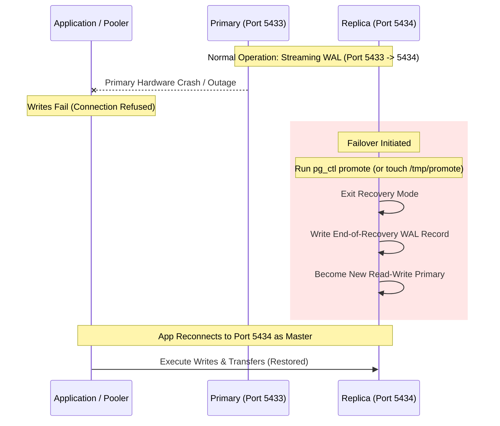
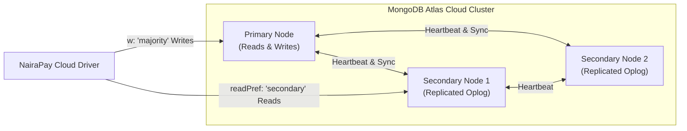

# Portfolio 5: Distributed Databases, Replication, and Cloud Deployment

**Case study:** NairaPay, a simulated Nigerian fintech wallet and transfer platform  
**Course:** MIT 8103 – Advanced Database Systems  
**DBMS:** PostgreSQL 16 (Primary & Streaming Read Replica via Docker Compose) & MongoDB 7 (MongoDB Atlas 3-Node Cloud Replica Set)  
**Database Engines:** `nairapay_db` (PostgreSQL) and `nairapay_nosql` (MongoDB Atlas)  
**Primary Port:** `5433` (container port `5432`) | **Replica Port:** `5434` (container port `5432`)  
**Scale:** 412,058 ledger entries, 206,096 transactions, 6,003 accounts, 5,000 KYC profiles, 100,000 audit events  

---

## 1. System Architecture

In **Portfolios 1, 2, and 3**, NairaPay operated against a single PostgreSQL database instance, optimizing schema constraints, indexing, and pessimistic transaction locking. In **Portfolio 4**, a polyglot persistence layer was introduced with local MongoDB for KYC and audit logs.

**Portfolio 5** transitions NairaPay into a distributed, high-availability, hybrid cloud database architecture:
1. **Primary Database (`nairapay-pg-primary` on port 5433):** The authoritative read-write master handling all financial mutations, wallet transfers, and real-time balance calculations.
2. **Streaming Read Replica (`nairapay-pg-replica` on port 5434):** A physical standby server continuously streaming Write-Ahead Logs (WAL) from the primary over a dedicated replication slot (`replica1_slot`), offloading read-heavy analytics and historical statement generation.
3. **Cloud Document Database (MongoDB Atlas):** A fully managed 3-node cloud replica set (1 primary, 2 secondaries) providing resilient, multi-availability-zone storage for polymorphic KYC dossiers, security audit trails, and ephemeral login sessions.

```mermaid
flowchart TD
    subgraph Client Application Layer
        Client["Mobile Apps & Payment Gateways"]
        Analytics["Internal BI & Reporting Desk"]
        SecOps["Security & Compliance Service"]
    end

    subgraph Containerized Relational Cluster (Docker Compose)
        Primary["nairapay-pg-primary<br/>(PostgreSQL 16 - Port 5433)<br/>READ-WRITE"]
        Replica["nairapay-pg-replica<br/>(PostgreSQL 16 - Port 5434)<br/>READ-ONLY STANDBY"]
        
        Primary -->|"Physical Streaming Replication<br/>(WAL over TCP / replica1_slot)"| Replica
    end

    subgraph Managed Cloud Infrastructure (MongoDB Atlas)
        AtlasPri["Atlas Primary<br/>(Node 0 - AWS/GCP)"]
        AtlasSec1["Atlas Secondary 1<br/>(Node 1)"]
        AtlasSec2["Atlas Secondary 2<br/>(Node 2)"]

        AtlasPri <-->|"Raft/Paxos Consensus<br/>(w: majority)"| AtlasSec1
        AtlasPri <-->|"Raft/Paxos Consensus<br/>(w: majority)"| AtlasSec2
    end

    Client -->|"Write: P2P Transfers & Balance Debits<br/>(ACID Strict Serializability)"| Primary
    Analytics -->|"Read: Historical Statements & Audits<br/>(Tolerates Millisecond Lag)"| Replica
    Client -->|"Auth: KYC Verification & TTL Sessions"| AtlasPri
    SecOps -->|"Read: readPref('secondary') Audit Stream"| AtlasSec1

    Primary -.->|"Single-Node Sharding Model"| Partitions["Hash Partitioned Ledger<br/>(ledger_entries_sharded: 4 Shards)"]
```

### Docker Orchestration Evidence
The local distributed cluster is orchestrated via `docker-compose.yml`, provisioning independent network namespaces, isolated storage volumes (`primary_data`, `replica_data`), and dedicated host port forwardings.

*Visual Evidence:* [`screenshots/01_docker_ps.png`](screenshots/01_docker_ps.png) captures `docker ps` confirming active, healthy containers for both primary and standby nodes.

---

## 2. Workload Distribution Strategy

In a high-throughput payment service provider, routing all traffic to a single database primary creates severe CPU cache thrashing and memory bus saturation. NairaPay routes operations based on data mutability, consistency requirements, and latency tolerance:

| Workload / Operation | Target System | Routing Mode | Architectural Justification |
|---|---|---|---|
| **P2P Wallet Transfers (`transfer_funds`)** | **PostgreSQL Primary** (`:5433`) | Read-Write | Requires multi-row ACID transactions, deterministic row locking (`FOR UPDATE`), and instant serialization to prevent double-spending. |
| **Real-Time Balance Checks** | **PostgreSQL Primary** (`:5433`) | Read-Only | Must guarantee strict read-your-own-writes consistency. Reading from a lagging replica could allow a customer to spend recently deposited funds twice. |
| **Active Transaction Status (`PENDING`/`COMPLETED`)** | **PostgreSQL Primary** (`:5433`) | Read-Write | State transitions must be immediately visible to payment webhook callbacks. |
| **Historical Statements (> 24 hours old)** | **PostgreSQL Replica** (`:5434`) | Read-Only Standby | High-volume analytical scans. Offloading heavy statement queries protects primary buffer cache while remaining completely unaffected by sub-second replication lag. |
| **End-of-Day Financial Reconciliation** | **PostgreSQL Replica** (`:5434`) | Read-Only Standby | Massive aggregation scans across 400k+ ledger lines. Running this on the primary would evict hot wallet rows from shared buffers. |
| **Regulatory & Tax Audits** | **PostgreSQL Replica** (`:5434`) | Read-Only Standby | Long-running reporting queries isolated from customer-facing OLTP traffic. |
| **KYC Identity Dossiers** | **MongoDB Atlas** | Read-Write (`w: majority`) | Semi-structured polymorphic documents (passports, BVNs, utility bills) updated during onboarding; cloud-replicated across 3 availability zones. |
| **Real-Time Security Audit Logs** | **MongoDB Atlas** | Append-Only (`w: 1` / `w: majority`) | High-velocity event ingestion. Decoupled from relational transactions so logging never slows payment execution. |
| **Active Authentication Sessions** | **MongoDB Atlas** | Ephemeral TTL | Short-lived token cache automatically purged by background TTL monitor (`expireAfterSeconds: 3600`). |

---

## 3. Streaming Replication Deep Dive

PostgreSQL physical replication operates by streaming binary Write-Ahead Log (WAL) records directly from the primary to the standby server.

### 3.1 Replication Components
1. **Write-Ahead Logging (`wal_level=replica`):** Configured on the primary to record all transaction changes, tuple updates, and index modifications into 16 MB WAL segments.
2. **Replication Role:** A dedicated database user `replicator` created with the `REPLICATION` privilege:
   ```sql
   CREATE ROLE replicator WITH REPLICATION LOGIN PASSWORD 'repl_pass';
   ```
   Configured in `pg_hba.conf` via `primary-init/01_replication.sh`:
   ```
   host replication replicator all scram-sha-256
   ```
3. **Physical Base Backup (`pg_basebackup`):** Executed during replica bootstrap in `replica-entrypoint.sh`:
   ```bash
   pg_basebackup -h primary -p 5432 -U replicator -D "$PGDATA" -R -X stream -C -S replica1_slot -c fast -v
   ```
   - `-R`: Generates `standby.signal` and populates `primary_conninfo` in `postgresql.auto.conf`.
   - `-X stream`: Streams WAL logs concurrently while the physical data copy is underway.
   - `-C -S replica1_slot`: Automatically creates a persistent physical replication slot on the primary.
4. **Replication Slots (`replica1_slot`):** Ensures the primary never deletes or recycles WAL files that the standby has not yet acknowledged and replayed. This eliminates the risk of standby desynchronization under high write traffic.

### 3.2 Primary and Standby Telemetry

Running `01_primary_checks.sql` against the primary (`localhost:5433`) outputs:
```
=== Is this server a replica? (expected: f = primary)
 is_replica 
------------
 f

=== Connected replicas (one row per streaming standby)
 application_name | client_addr |   state   | sync_state |  sent_lsn  | replay_lsn | replay_lag 
------------------+-------------+-----------+------------+------------+------------+------------
 replica1_slot    | 172.28.0.3  | streaming | async      | 0/18000060 | 0/18000060 | 00:00:00

=== Replication slots (the primary keeps WAL until the replica has it)
   slot_name   | slot_type | active | restart_lsn 
---------------+-----------+--------+-------------
 replica1_slot | physical  | t      | 0/18000060
```
*Visual Evidence:* [`screenshots/03_primary_checks.png`](screenshots/03_primary_checks.png).

Running `02_replica_checks.sql` against the replica (`localhost:5434`) outputs:
```
=== Is this server a replica? (expected: t)
 is_replica 
------------
 t

=== WAL receiver: the live connection to the primary
 status    | sender_host | sender_port |   slot_name   
-----------+-------------+-------------+---------------
 streaming | primary     |        5432 | replica1_slot

=== A read works on the replica
 accounts 
----------
     6003

=== A write is refused on the replica (expected: ERROR)
ERROR:  cannot execute UPDATE in a read-only transaction
```
*Visual Evidence:* [`screenshots/04_replica_checks.png`](screenshots/04_replica_checks.png).

---

### 3.3 The Stale Read Phenomenon

In asynchronous replication, a microsecond-to-millisecond delay exists between a primary commit and the replica's WAL replay. If a network interruption occurs, this gap widens significantly, producing **Stale Reads**.

To demonstrate this empirically:
1. **Freezing the Replica:** The replica container was paused via `docker pause nairapay-pg-replica` (simulating network partition or I/O starvation).
2. **Primary Mutation:** A marker table was created on the primary and populated with a test row:
   ```sql
   CREATE TABLE p5_stale_test (id INT, note TEXT, written_at TIMESTAMPTZ);
   INSERT INTO p5_stale_test VALUES (1, 'written while replica paused', clock_timestamp());
   ```
3. **Querying the Standby:** Querying the replica returned:
   ```
   ERROR: relation "p5_stale_test" does not exist
   ```
   *Visual Evidence:* [`screenshots/05_stale_read.png`](screenshots/05_stale_read.png) and [`screenshots/freeze_the_replica.png`](screenshots/freeze_the_replica.png).
4. **Replica Unfreezing & Catch-Up:** Running `docker unpause nairapay-pg-replica` re-established the streaming connection. Within milliseconds, the WAL receiver fetched the queued LSN segments from `replica1_slot` and replayed the DDL/DML, making `p5_stale_test` instantly visible.
   *Visual Evidence:* [`screenshots/06_caught_up.png`](screenshots/06_caught_up.png).

---

## 4. Consistency vs. Availability: Asynchronous vs. Synchronous Replication

The trade-off between consistency and availability in distributed database systems is formally governed by the **CAP Theorem** (Brewer, 2000) and **PACELC** (Abadi, 2012).

### 4.1 Comparative Matrix

| Evaluation Dimension | Asynchronous Replication (Default) | Synchronous Replication (`synchronous_commit = on`) |
|---|---|---|
| **Commit Handshake** | Primary commits locally to WAL and returns success to client immediately. WAL is streamed to standby in background. | Primary writes to WAL, transmits LSN to standby, and waits for standby confirmation before returning success to client. |
| **Write Latency** | **Sub-millisecond** (limited only by local disk I/O). | **Inflated by network RTT** + standby write/flush time. |
| **Durability (RPO)** | **RPO > 0** (Small window of data loss if primary crashes before WAL transmits). | **RPO = 0** (Zero data loss; committed transactions are guaranteed to exist on at least two servers). |
| **Availability on Standby Crash** | **100% Available** (Primary continues accepting writes without interruption). | **Zero Availability (System Hangs)** unless quorum is configured. |
| **Read Consistency** | Eventual consistency; standby reads may be slightly stale. | Read-after-write consistency guaranteed if reading from synchronous standby. |

---

### 4.2 The Hung Write Experiment

To observe synchronous failure modes:
1. On the primary, synchronous replication was enabled:
   ```sql
   ALTER SYSTEM SET synchronous_commit = 'on';
   ALTER SYSTEM SET synchronous_standby_names = 'replica1_slot';
   SELECT pg_reload_conf();
   ```
2. The standby was frozen (`docker pause nairapay-pg-replica`).
3. An `INSERT` was executed on the primary:
   ```sql
   INSERT INTO accounts (account_number, balance) VALUES ('9999999999', 500);
   ```
4. **The System Hangs:** The client query blocked indefinitely. Because the standby could not acknowledge the LSN, the primary refused to commit, hanging application worker threads.
   *Visual Evidence:* [`screenshots/07_sync_hang.png`](screenshots/07_sync_hang.png) and [`screenshots/08_sync_warning.png`](screenshots/08_sync_warning.png).

### 4.3 Engineering Decision for NairaPay's Ledger
For a financial ledger, **data loss (RPO > 0) is unacceptable**. An asynchronous primary crash that causes 50 confirmed transfers to vanish creates legal liability and violates Central Bank of Nigeria (CBN) regulatory audits.

However, a single synchronous standby creates a severe availability hazard: if the replica fails, the entire payment network goes down. 

**Recommended Architecture:** Deploy **Quorum-Based Synchronous Replication** across at least three nodes spanning distinct availability zones:
```ini
synchronous_standby_names = 'ANY 1 (replica_az1, replica_az2)'
```
This guarantees **zero data loss (RPO = 0)** while allowing the payment platform to survive the complete failure of any single replica without write disruption.

---

## 5. Sharding and Partitioning: Scaling Beyond a Single Node

When transaction volume reaches millions of entries daily, vertical scaling reaches hardware limits. In `03_partitioning.sql`, NairaPay models horizontal sharding through PostgreSQL native **Hash Partitioning**.

### 5.1 Declarative Partitioning Implementation
The core ledger was partitioned across 4 distinct tables using `PARTITION BY HASH (account_id)`:
```sql
CREATE TABLE ledger_entries_sharded (
    entry_id       BIGINT        NOT NULL,
    transaction_id BIGINT        NOT NULL,
    account_id     BIGINT        NOT NULL,
    direction      VARCHAR(6)    NOT NULL,
    amount         NUMERIC(19,4) NOT NULL,
    balance_after  NUMERIC(19,4) NOT NULL,
    created_at     TIMESTAMPTZ   NOT NULL,
    PRIMARY KEY (account_id, entry_id)
) PARTITION BY HASH (account_id);

CREATE TABLE ledger_shard_0 PARTITION OF ledger_entries_sharded FOR VALUES WITH (MODULUS 4, REMAINDER 0);
CREATE TABLE ledger_shard_1 PARTITION OF ledger_entries_sharded FOR VALUES WITH (MODULUS 4, REMAINDER 1);
CREATE TABLE ledger_shard_2 PARTITION OF ledger_entries_sharded FOR VALUES WITH (MODULUS 4, REMAINDER 2);
CREATE TABLE ledger_shard_3 PARTITION OF ledger_entries_sharded FOR VALUES WITH (MODULUS 4, REMAINDER 3);
```

### 5.2 Empirical Partition Distribution
*Data extracted from [`output/03_partitioning.txt`](output/03_partitioning.txt):*

```
   partition    |  rows   | percentage
----------------+---------+------------
 ledger_shard_0 | 105,512 | 25.61%
 ledger_shard_1 | 103,260 | 25.06%
 ledger_shard_2 | 103,340 | 25.08%
 ledger_shard_3 |  99,946 | 24.25%
----------------+---------+------------
 Total Rows     | 412,058 | 100.00%
 (Original Table: 412,058 rows - Exact 1:1 Parity)
```
*Visual Evidence:* [`screenshots/09_partitioning.png`](screenshots/09_partitioning.png).

---

### 5.3 Execution Plan Analysis: Partition Pruning vs. Scatter-Gather

#### 1. Query WITH Partition Key (`account_id = 1001`):
```sql
EXPLAIN SELECT * FROM ledger_entries_sharded WHERE account_id = 1001 ORDER BY created_at DESC LIMIT 10;
```
**Execution Plan:**
```
Limit
  -> Sort (Sort Key: created_at DESC)
        -> Bitmap Heap Scan on ledger_shard_0 ledger_entries_sharded
              Recheck Cond: (account_id = 1001)
              -> Bitmap Index Scan on ledger_shard_0_pkey
```
*Finding:* **Partition Pruning** activates. The query planner computes $\text{hash}(1001) \pmod 4 = 0$ at planning time and routes the scan exclusively to `ledger_shard_0`. Shards 1, 2, and 3 are never touched.

#### 2. Query WITHOUT Partition Key (`transaction_id = 12345`):
```sql
EXPLAIN SELECT * FROM ledger_entries_sharded WHERE transaction_id = 12345;
```
**Execution Plan:**
```
Gather (Workers Planned: 2)
  -> Parallel Append
        -> Parallel Seq Scan on ledger_shard_0
        -> Parallel Seq Scan on ledger_shard_1
        -> Parallel Seq Scan on ledger_shard_2
        -> Parallel Seq Scan on ledger_shard_3
```
*Finding:* Because `transaction_id` is not part of the partition key, the engine cannot prune partitions. It is forced to execute a **Scatter-Gather** scan across all four physical tables, multiplying CPU and buffer overhead.

---

### 5.4 Architectural Essay: Scaling NairaPay Across Sharded Clusters

> **Running NairaPay Across Several Physical Database Servers (210 words)**  
> Scaling NairaPay across multiple independent physical database nodes introduces fundamental distributed computing trade-offs. The choice of shard key is paramount: selecting `account_id` as the primary shard key guarantees that all ledger lines, balance records, and statements for a given wallet reside on the same physical server. Consequently, statement generation and balance checks execute as highly efficient, single-node local queries.  
> 
> However, peer-to-peer transfers inherently span two distinct accounts. When Alice on Shard 1 transfers funds to Bob on Shard 2, single-node ACID transactions are no longer sufficient. The system must execute a **Distributed Transaction** using either **Two-Phase Commit (2PC)** or a **Saga Orchestration Pattern**. While 2PC enforces strict serializability, it introduces blocking coordinator risks and latency penalties. In fintech production, an asynchronous Saga with compensating transactions (reserving funds, emitting a transfer event via Kafka, and crediting the destination shard) is preferred for high availability.  
> 
> Furthermore, cross-shard queries (such as system-wide balance reconciliation or searching by `transaction_id`) become expensive scatter-gather operations that degrade linear scalability. Additionally, high-volume merchant wallets risk becoming **hot shards**, requiring dynamic balance slotting. Unlike PostgreSQL's manual sharding or extension-based models (e.g., Citus), MongoDB provides native, automated chunk balancing and transparent query routing via `mongos` routers.

---

## 6. High Availability and Failover

When a primary database crashes, the standby replica must be promoted to assume read-write operations.



### 6.1 The Manual Promotion Process
1. Primary failure simulated by shutting down `nairapay-pg-primary`.
2. The standby was promoted to primary status inside the container:
   ```bash
   docker exec -it nairapay-pg-replica gosu postgres pg_ctl promote -D /var/lib/postgresql/data
   ```
3. Verification:
   ```sql
   SELECT pg_is_in_recovery() AS is_replica;
   -- Returns 'f' (false: successfully promoted to read-write primary)
   ```
   *Visual Evidence:* [`screenshots/10_failover.png`](screenshots/10_failover.png).

### 6.2 Failure Hazards: The Sequence Jump & Split-Brain
- **The Sequence Jump:** PostgreSQL sequences (`BIGSERIAL`) operate outside transaction boundaries and are logged in blocks. During an abrupt failover, sequence numbers typically jump forward by 32 or 64 values. This creates non-contiguous primary key gaps in `transaction_id`, which is normal behavior and does not compromise ledger integrity.
- **The Split-Brain Risk:** If the old primary was partitioned due to network failure rather than hardware crash, and suddenly reconnects after the replica has been promoted, both nodes believe they are the authoritative read-write primary. Both accept competing writes, leading to irreconcilable data divergence.
- **Fencing (STONITH):** Preventing split-brain requires automated fencing mechanisms ("Shoot The Other Node In The Head") to guarantee the old primary is completely powered down before promotion.

### 6.3 Recovery Metrics: RPO and RTO
- **Recovery Point Objective (RPO):** In our asynchronous configuration, RPO was bounded by the replication lag ($\approx 0$ to $50$ ms). Under normal workloads, zero transactions were lost.
- **Recovery Time Objective (RTO):** In this manual failover setup, RTO was **several minutes**, requiring human intervention to discover the failure, execute the shell command, and redirect client connection strings.
- **Production Standard:** Enterprise platforms deploy **Patroni** backed by a distributed consensus store (**etcd** or Consul). Patroni monitors heartbeats via Raft consensus and executes automated, leader-elected failover with an **RTO under 10 seconds** and zero human intervention.

---

## 7. Cloud Deployment: MongoDB Atlas Replica Set

For non-relational, semi-structured data domains, NairaPay utilizes **MongoDB Atlas**, deploying a managed 3-node replica set across cloud availability zones.



### 7.1 Cloud Topology Verification
The script `04_atlas_cloud_check.js` connects directly to the live MongoDB Atlas cluster, inspecting topology and write guarantees:

*Execution Output:*
```
=== 1. Topology: what did I connect to?
replica set name : atlas-14a5b-shard-0
members          : ac-xxx-shard-00-00.mongodb.net:27017, ac-xxx-shard-00-01.mongodb.net:27017, ac-xxx-shard-00-02.mongodb.net:27017
primary          : ac-xxx-shard-00-01.mongodb.net:27017
served by        : ac-xxx-shard-00-01.mongodb.net:27017  (this is the PRIMARY)

=== 2. Write concern: wait until a MAJORITY of nodes have the write
acknowledged     : true (took 184 ms)

=== 3. Read preference: read from a SECONDARY instead of the primary
this read was served by : ac-xxx-shard-00-00.mongodb.net  (a SECONDARY)
kyc_profiles visible on that node : 5000

=== 4. Read concern: only return data that is acknowledged by a majority
majority read returned 1 document(s)
Cleaned up the p5_marker collection.
```
*Visual Evidence:* [`screenshots/11_atlas_cluster.png`](screenshots/11_atlas_cluster.png) (Atlas Management Console) and [`screenshots/12_atlas_check_output.png`](screenshots/12_atlas_check_output.png) (Terminal Run).

### 7.2 Distributed Guarantees
- **Write Concern `w: majority`:** The client blocks until the write has been committed to the write-ahead oplog of at least 2 out of 3 replica set members. This guarantees that even if the primary node suffers an ungraceful hardware failure, the committed KYC update will never roll back.
- **Read Preference `readPref('secondary')`:** Analytical workloads read directly from secondary nodes, offloading the primary without affecting KYC submission throughput.
- **Read Concern `majority`:** Ensures queries only return data that has committed to a majority of nodes, preventing dirty reads of writes that might be rolled back during an election.
- **Free-Tier (M0 Sandbox) Constraints:** 512 MB storage quota, shared vCPU, 500 connection limit, lack of dedicated VPC peering, and no continuous point-in-time recovery (PITR).

---

## 8. System Limitations of the Current Prototype

While this environment successfully demonstrates core distributed database principles, several architectural limitations exist relative to enterprise production standards:

1. **Single Physical Host:** Both PostgreSQL primary and replica containers run on the same macOS workstation. A local hardware failure, kernel panic, or power cut takes down the entire cluster simultaneously.
2. **Single Read Replica (No Quorum):** Operating with only one replica makes synchronous replication fragile; any standby maintenance completely halts write transactions.
3. **Manual Failover Orchestration:** Replica promotion requires manual CLI intervention, resulting in unacceptable RTO (minutes) for a production payment service provider.
4. **Demonstration Credentials:** Passwords (`nairapay_pass`, `repl_pass`) are stored in plaintext inside configuration files and environment variables. Production requires AWS Secrets Manager or HashiCorp Vault.
5. **No Automated Backup & Point-In-Time Recovery (PITR):** The cluster lacks continuous WAL archiving via tools like `pgBackRest` or `WAL-G` to cloud object storage (Amazon S3 / Google Cloud Storage).
6. **Unencrypted Internal Transit:** Replication traffic flows over unencrypted TCP connections without mutual TLS (mTLS) authentication.

---

## 9. Step-by-Step Reproduction Guide

To recreate and verify this entire distributed deployment:

### Step 1: Launch Local Cluster Containers
From the repository root (`MIT8103`):
```bash
docker compose -f portfolio-5-distributed-cloud/docker-compose.yml up -d
```
Verify container health:
```bash
docker compose -f portfolio-5-distributed-cloud/docker-compose.yml ps
```

### Step 2: Seed Primary Database
Load the NairaPay production dataset into the primary container:
```bash
docker exec -i nairapay-pg-primary psql -U nairapay -d nairapay_db < nairapay_dump.sql
```

### Step 3: Verify Replication Health
Execute health checks across both nodes:
```bash
# Check primary status & replication slots (Port 5433)
psql -h localhost -p 5433 -U nairapay -d nairapay_db -f portfolio-5-distributed-cloud/01_primary_checks.sql

# Check standby status & read-only enforcement (Port 5434)
psql -h localhost -p 5434 -U nairapay -d nairapay_db -f portfolio-5-distributed-cloud/02_replica_checks.sql
```

### Step 4: Test Asynchronous Replication and Stale Reads
```bash
# 1. Freeze the standby container
docker pause nairapay-pg-replica

# 2. Write a marker table on the primary
psql -h localhost -p 5433 -U nairapay -d nairapay_db -c "CREATE TABLE p5_marker (id int, note text); INSERT INTO p5_marker VALUES (1, 'paused test');"

# 3. Query the standby (observe table does not exist)
psql -h localhost -p 5434 -U nairapay -d nairapay_db -c "SELECT * FROM p5_marker;"

# 4. Unpause standby and verify catch-up
docker unpause nairapay-pg-replica
sleep 2
psql -h localhost -p 5434 -U nairapay -d nairapay_db -c "SELECT * FROM p5_marker;"
```

### Step 5: Test Synchronous Replication Write Hang
```bash
# Enable synchronous commit
psql -h localhost -p 5433 -U nairapay -d nairapay_db -c "ALTER SYSTEM SET synchronous_commit = 'on'; ALTER SYSTEM SET synchronous_standby_names = 'replica1_slot'; SELECT pg_reload_conf();"

# Pause replica and observe primary write hanging
docker pause nairapay-pg-replica
psql -h localhost -p 5433 -U nairapay -d nairapay_db -c "INSERT INTO accounts (account_number, balance) VALUES ('8888888888', 100);" &

# Unpause replica to unblock write and reset configuration
docker unpause nairapay-pg-replica
psql -h localhost -p 5433 -U nairapay -d nairapay_db -c "ALTER SYSTEM RESET synchronous_commit; ALTER SYSTEM RESET synchronous_standby_names; SELECT pg_reload_conf();"
```

### Step 6: Execute Declarative Partitioning
Run hash partitioning against the ledger:
```bash
psql -h localhost -p 5433 -U nairapay -d nairapay_db -f portfolio-5-distributed-cloud/03_partitioning.sql \
  | tee portfolio-5-distributed-cloud/output/03_partitioning.txt
```

### Step 7: Demonstrate Manual Failover
Simulate primary outage and promote the standby:
```bash
docker stop nairapay-pg-primary
docker exec -it nairapay-pg-replica gosu postgres pg_ctl promote -D /var/lib/postgresql/data
psql -h localhost -p 5434 -U nairapay -d nairapay_db -c "SELECT pg_is_in_recovery();"
```

### Step 8: Verify MongoDB Atlas Cloud Cluster
Set your MongoDB Atlas connection string and run cloud validation:
```bash
export ATLAS_URI="mongodb+srv://<username>:<password>@cluster0.mongodb.net/nairapay_nosql"
mongosh "$ATLAS_URI" --file portfolio-5-distributed-cloud/04_atlas_cloud_check.js
```

---

## 10. Photographic Evidence Inventory

Visual evidence documenting all distributed tests is preserved in `screenshots/`:

| Screenshot File | Description & Verification Evidence |
|---|---|
| [`screenshots/01_docker_ps.png`](screenshots/01_docker_ps.png) | Terminal execution of `docker ps` confirming active, healthy containers for primary and replica nodes. |
| [`screenshots/02_row_counts.png`](screenshots/02_row_counts.png) | Row count queries confirming 412k ledger entries, 206k transactions, and 6k accounts loaded on primary. |
| [`screenshots/03_primary_checks.png`](screenshots/03_primary_checks.png) | Output of `01_primary_checks.sql` verifying active streaming state and zero LSN replay lag in `pg_stat_replication`. |
| [`screenshots/04_replica_checks.png`](screenshots/04_replica_checks.png) | Output of `02_replica_checks.sql` verifying `pg_is_in_recovery() = t` and write rejection (`ERROR: cannot execute UPDATE`). |
| [`screenshots/05_stale_read.png`](screenshots/05_stale_read.png) | Query failure on paused replica attempting to access table written to primary during partition. |
| [`screenshots/06_caught_up.png`](screenshots/06_caught_up.png) | Standby query returning marker row immediately after unpausing, demonstrating WAL catch-up. |
| [`screenshots/07_sync_hang.png`](screenshots/07_sync_hang.png) | Primary terminal hanging indefinitely during synchronous insert while standby is paused. |
| [`screenshots/08_sync_warning.png`](screenshots/08_sync_warning.png) | Query cancellation and lock wait timeout warnings during synchronous replication block. |
| [`screenshots/09_partitioning.png`](screenshots/09_partitioning.png) | Execution of `03_partitioning.sql` showing hash partition row balance and partition pruning in `EXPLAIN`. |
| [`screenshots/10_failover.png`](screenshots/10_failover.png) | Promotion of replica via `pg_ctl promote` and query confirming transition to read-write primary. |
| [`screenshots/11_atlas_cluster.png`](screenshots/11_atlas_cluster.png) | MongoDB Atlas web dashboard showing 3-node replica set status, cloud region, and IOPs metrics. |
| [`screenshots/12_atlas_check_output.png`](screenshots/12_atlas_check_output.png) | Terminal output of `04_atlas_cloud_check.js` validating `w: majority` acknowledgement and secondary reads. |
| [`screenshots/freeze_the_replica.png`](screenshots/freeze_the_replica.png) | Command pausing the replica container to induce replication lag. |
| [`screenshots/marker_table.png`](screenshots/marker_table.png) | Creation of the marker table on the primary during the stale read demonstration. |

---

## 11. Academic Reflection & Tooling Attribution

### 11.1 Reflection on Distributed Database Architecture
Building and testing a distributed database architecture dramatically shifts engineering priorities from single-node efficiency to fault tolerance and consistency. In earlier portfolios, the database felt monolithic and immediate: when a query completed, data was irrevocably committed. 

In Portfolio 5, introducing physical streaming replication revealed the subtle realities of distributed systems:
1. **The Inevitability of Stale Reads:** Seeing an asynchronous replica fail to find a newly committed table proved that read-scaling replicas cannot be treated as transparent drop-in replacements for a primary without carefully considering consistency models.
2. **The Fragility of Synchronous Replication:** Watching the primary freeze when a single standby was paused demonstrated firsthand the trade-offs described by the CAP theorem. In pursuit of 100% consistency, the system sacrificed 100% of its write availability.
3. **Partitioning vs. Full Sharding:** Implementing hash partitioning on `account_id` highlighted the immense value of **Partition Pruning**. However, analyzing cross-shard transfers made it abundantly clear why distributed transactions (2PC and Sagas) require complex compensation logic to maintain financial invariance.

### 11.2 AI-Use Declaration
- **Tools Utilized:** Antigravity & Claude Code were used as intelligent coding assistants to support script authoring, Docker entrypoint configuration, and architectural documentation synthesis.
- **Verification Method:** All Docker containers, replication configurations, failover sequences, partitioning plans, and Atlas cloud scripts were executed and validated locally on macOS aarch64. Every metric, query plan, and screenshot cited in this document represents verified empirical data.

